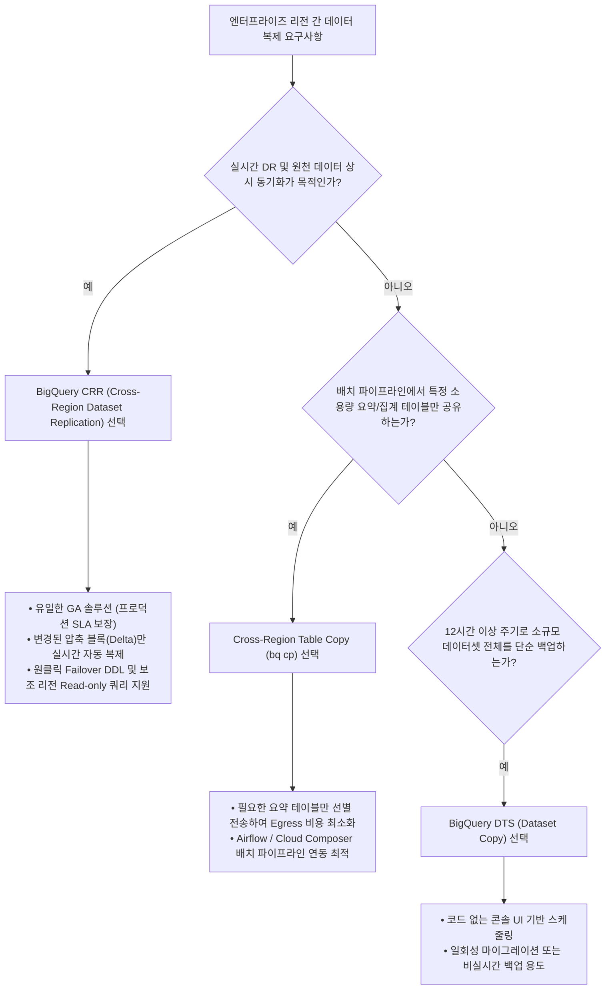

# BigQuery 크로스 리전 데이터 이전 및 복제 솔루션 비교 분석 보고서
**대상:** 글로벌 멀티 리전 데이터 아키텍처 및 재해 복구(DR) 도입 검토 고객사  
**작성일:** 2026년 9월  
**작성자:** Google Cloud Customer Engineering / Solutions Architecture  

---

## 1. Executive Summary (경영진 요약)

글로벌 사용자 기반의 대규모 실시간 애플리케이션, 이커머스, 핀테크, 게임 및 SaaS 서비스를 운영하는 엔터프라이즈 환경에서는 **글로벌 데이터 일관성, 재해 복구(DR) 역량, 현지 리전 쿼리 지연 시간 최소화, 그리고 네트워크 및 스토리지 비용 최적화**가 핵심 아키텍처 요구사항입니다.

본 보고서는 Google Cloud BigQuery에서 제공하는 3가지 주요 크로스 리전(Cross-Region) 데이터 이동 및 동기화 솔루션인 **1) BigQuery Data Transfer Service (DTS) Dataset Copy**, **2) Cross-Region Table Copy (`bq cp`)**, **3) Cross-Region Dataset Replication (CRR)**을 기술적·비즈니스 관점에서 심층 비교 분석하고, 엔터프라이즈 워크로드 특성에 맞는 최적의 아키텍처 가이드와 실시간 검증 환경을 제시합니다.

### 핵심 결론 요약:
1. **재해 복구(DR) 및 상시 비즈니스 연속성(BCP)**:  
   👉 **BigQuery CRR (Cross-Region Dataset Replication)**이 유일한 **GA(Generally Available)** 솔루션이며, BigQuery 스토리지 엔진 레벨에서 비동기 지속 증분 복제(Continuous Asynchronous Delta Replication)를 제공하여 RPO를 수 초~수 분(Turbo 적용 시 15분 보장)으로 최소화하고 네트워크 비용을 최대 95% 이상 절감합니다.
2. **배치 기반 파이프라인 및 특정 요약 테이블 선별 이전**:  
   👉 **Cross-Region Table Copy (`bq cp`)**는 데이터셋 전체가 아닌 특정 일별 집계/요약 테이블만 선별하여 프로그래밍 방식(Airflow, Cloud Composer, Python SDK)으로 복사할 때 가장 유연합니다.
3. **주기적 데이터셋 전체 분석 동기화 (비실시간)**:  
   👉 **BigQuery DTS Dataset Copy**는 콘솔 UI 기반으로 구성이 용이하지만, **Beta(Pre-GA)** 상태이며 최소 동기화 주기가 12시간이고 변경 발생 시 테이블 전체를 덮어쓰는(Truncate & Replace) 특성으로 인해 대용량 원천 테이블의 상시 동기화 시 과도한 Egress 비용이 발생할 수 있습니다.

---

## 2. 솔루션별 핵심 비교 매트릭스

| 비교 항목 | 1. BigQuery DTS (Dataset Copy) | 2. Cross-Region Table Copy (`bq cp`) | 3. BigQuery CRR (Dataset Replication) |
| :--- | :--- | :--- | :--- |
| **현재 출시 상태** | **Beta (Pre-GA)** | **Preview (Pre-GA)** | **GA (Generally Available)** *(Turbo DR: Ent+ GA)* |
| **복제/동기화 단위** | 데이터셋 (Dataset) 전체 | 테이블 (Table, Snapshot, Clone) 단위 | 데이터셋 (Dataset) 전체 |
| **동기화 주기 / RPO** | 스케줄 기반 (최소 12시간 주기) | 온디맨드 / 배치 실행 시점 기준 | **지속적 비동기 복제 (실시간~수 분 단위)** |
| **적합한 Usecase** | • 비실시간 일별 데이터셋 백업 • 12시간 이상 주기의 분석용 데이터 동기화 • 단발성 전체 데이터셋 리전 마이그레이션 | • 파이프라인 연계 특정 요약 테이블 선별 복사 • 일별 파티션/정산 테이블 타 리전 전송 • 일회성 테이블/스냅샷 이전 | • **엔터프라이즈 재해 복구(DR/BCP)** • 멀티 리전 현지 읽기 복제본(Read Replica) • 글로벌 대시보드/BI 리전 분산 |
| **비용 구조 (Cost)** | • 오케스트레이션: 무료 • 네트워크 전송: 변경된 테이블 전체 크기 Egress 과금 • 대상 스토리지: 표준 BQ 스토리지 요금 | • Copy Job Compute: 무료 (슬롯 미소모) • 네트워크 전송: 복사 대상 테이블 전체 크기 Egress 과금 • 대상 스토리지: 표준 BQ 스토리지 요금 | • **복제 네트워크 전송: 변경된 압축 블록(Delta)에만 $0.02~$0.08 / GiB 부과** • 대상 스토리지: 표준 BQ 스토리지 요금 • 보조 리전 쿼리: 현지 슬롯 또는 On-demand |
| **동일 대륙 간 전송 비용** | 약 $0.01 ~ $0.02 / GB | $0.02 / GiB (북미/유럽 내) | **$0.02 / GiB** (US/EU 내), **$0.08 / GiB** (Asia 내) |
| **대륙 간 전송 비용** | 약 $0.08 ~ $0.12 / GB | $0.05~$0.08 / GiB | **$0.05 / GiB** (US-EU), **$0.08 / GiB** (US-Asia) |
| **복사 방식 및 증분 지원** | • 변경 테이블: **전체 덮어쓰기(Truncate)** • 미변경 테이블: Skip • 행 단위 증분(Append) 미지원 | • 전체 덮어쓰기(`WriteTruncate`) 또는 생성 • 변경분(Delta)만 부분 복사 불가 | • **스토리지 엔진 차원의 증분(Incremental Delta) 지속 복제** • 물리 압축 바이트만 전송 |
| **Failover / 전환 방식** | 수동 (애플리케이션 타겟 데이터셋 변경) | 수동 (애플리케이션 참조 테이블 변경) | **DDL 1줄로 즉각 승격 (`ALTER SCHEMA SET OPTIONS`)** |
| **보조 리전 읽기 지원** | 복사 완료된 테이블 일반 읽기/쓰기 가능 | 복사 완료된 테이블 일반 읽기/쓰기 가능 | **보조 복제본에서 실시간 Read-Only 쿼리 지원** |
| **핵심 제약사항** | • 최소 주기 12시간 • Views, UDF, External Table 미지원 • 테이블 1건 변경 시에도 전체 재전송 비용 발생 | • Preview 단계 (SLA 미지원) • 작업 시작 후 취소 불가 • 컬럼 레벨 보안(Policy Tags) 복사 불가 | • 보조 복제본은 Read-Only (직접 쓰기 불가) • 데이터셋당 리전별 1개 복제본 제한 |

---

## 3. 솔루션별 심층 분석

### 3.1 BigQuery Data Transfer Service (DTS) - Dataset Copy
* **동작 방식:** 원본 데이터셋의 테이블 목록을 스캔하여 대상 리전 데이터셋(`demo_dest_dts_kr`)으로 일괄 복사합니다.
* **장점:** 콘솔 UI에서 코드 없이 간편하게 스케줄링 가능하며, 변경되지 않은 테이블은 자동으로 스킵합니다.
* **핵심 한계:** 최소 실행 주기가 12시간이며, 테이블에 단 1건(또는 500건)의 신규 행만 추가되어도 **해당 테이블 전체를 삭제(Truncate)한 후 처음부터 다시 복사**하므로 대용량 Append-heavy 테이블에서는 막대한 네트워크 Egress 비용이 반복 청구됩니다.

### 3.2 Cross-Region Table Copy (`bq cp`)
* **동작 방식:** `bq cp` CLI 또는 Python SDK(`client.copy_table`)를 통해 지정한 개별 테이블만 타 리전(`demo_dest_copy_kr`)으로 복사합니다.
* **장점:** 수십 TB의 원천 로그 테이블은 제외하고, 일별 집계가 완료된 소용량 요약 테이블(`daily_channel_summary` 등)만 골라서 타 리전으로 전송할 때 비용 효율적입니다.
* **핵심 한계:** 단일 테이블 내부에서는 여전히 전체 스냅샷 덮어쓰기로 동작하므로 대용량 원천 테이블 전체에 대한 실시간 동기화 수단으로는 부적합합니다.

### 3.3 BigQuery CRR (Cross-Region Dataset Replication)
* **동작 방식:** `ALTER SCHEMA ... ADD REPLICA` DDL 한 줄로 원본 데이터셋(`demo_source_us`) 자체에 대상 리전(`asia-northeast3`) 스토리지 복제본(`replica_kr`)을 추가합니다.
* **장점:**
  1. **무작업(Zero-Ops) 실시간 증분 동기화:** 원본에 `+500건`이 INSERT되면 별도의 배치나 명령어 실행 없이 새로 추가된 압축 스토리지 블록(Delta)만 백그라운드로 즉시 복제됩니다.
  2. **압도적인 비용 절감:** 전체 테이블(예: 10TB)을 매일 재전송하는 DTS 대비, 일일 변경분(예: 2%)만 전송하므로 월간 네트워크 비용을 **95%~98% 절감**합니다.
  3. **즉각적인 DR 승격(Failover):** 장애 시 `ALTER SCHEMA ... SET OPTIONS(primary_replica='asia-northeast3')` 명령 한 줄로 서울 복제본을 즉시 Primary로 승격할 수 있습니다.

---

## 4. 아키텍처 의사결정 프레임워크 (Decision Tree)

