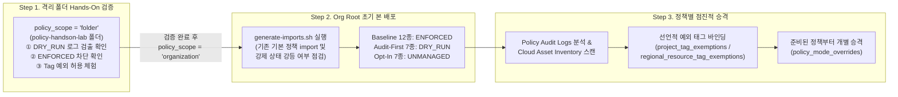

# GCP Minimal Organization Policies (Baseline · Audit-First · Tag Exemptions)

신규 구축하거나 운영 중인 GCP Organization에 **기존 워크로드 중단 위험 없이 핵심 보안 가드레일(Minimal Baseline)을 수립**하고, **네이티브 `DRY_RUN` 감사 · 목적별 독립 Resource Manager Tag(`exempt-*=true`) 조건부 예외 · 정책별 점진적 강제 전환**을 선언형(Declarative) Terraform으로 운영하는 실전 코드 에셋 및 Hands-On 가이드입니다.

---

## 1. 배경 및 3단계 정책 티어 아키텍처

### 1.1 왜 모든 조직 정책을 한 번에 강제(`ENFORCED`)하지 않나요?

GCP Organization에 수십 개의 보안 제약조건을 처음부터 일괄 강제(`ENFORCED`)하면 CI/CD 파이프라인 배포 실패, 기존 공개 에셋 버킷 `403` 차단, 외부 파트너 연동 장애 등 예기치 않은 운영 중단이 발생하기 쉽습니다. 반대로 정책을 비워두면 신규 프로젝트 생성 시 과도한 기본 권한(`Editor`)을 가진 Default Service Account나 `default` VPC가 무방비로 생성됩니다.

본 에셋은 Google Cloud 권고 Organization Policies 중 실무 필수 항목 **26종**을 엄선하여 **운영 영향도와 `DRY_RUN` 지원 여부에 따라 3개 티어(Tier)** 로 분류하고, 준비된 정책부터 **개별 정책 단위(`policy_mode_overrides`)** 로 안전하게 승격할 수 있도록 설계되었습니다.

| 정책 티어 (`Tier`) | 수량 | 초기 기본 모드 | 권장 운영 방식 및 선정 기준 |
| :--- | :---: | :---: | :--- |
| **`Baseline Guardrails`**<br>(`baseline`) | **12종** | **`ENFORCED`** | 기존 운영 리소스에 소급 장애를 일으키지 않는 기본 보안 가드레일 (신규 프로젝트 `default` VPC 생성 스킵, Default SA 자동 권한 차단, 유출 키 자동 비활성화, 차세대 DRS, 비소급 Cloud SQL 공인 IP 차단 등) |
| **`Audit-First Managed`**<br>(`audit_first`) | **7종** | **`DRY_RUN`** | GCP API에서 `dry_run_spec`과 하위 리소스 직접 태그 예외를 네이티브 지원하는 `.managed.` 제약조건 (SA 키 생성·업로드 차단, OS Login, 신뢰 이미지, 프로토콜 포워딩, VM 외부 IP 차단, Cloud Run Invoker IAM) — **차단 없이 Cloud Audit Logs로 위반 현황만 먼저 수집** 후 예외 태그 부착 뒤 `ENFORCED` 전환 |
| **`Opt-In Controls`**<br>(`opt_in`) | **7종** | **`UNMANAGED`** | 레거시 API 특성상 `dry_run_spec`을 지원하지 않거나 소급 차단 위험이 있는 스토리지·서버리스 네트워크 정책 (GCS 공개 차단, UBLA, Cloud Run/Functions 인그레스·이그레스 5종) — **Cloud Asset Inventory 스캔 및 프로젝트 단위 예외 태그 선부착 완료 정책부터 개별 `ENFORCED` 활성화** |
| *(코드 배제)*<br>과잉 통제 지양 | - | 미포함 | `gcp.resourceLocations`(글로벌/멀티리전 AI 엔드포인트 차단 위험), `gcp.restrictServiceUsage` 등 초기 개발 민첩성을 과도하게 저해하는 항목은 기본 에셋에서 배제 |

---

### 1.2 End-to-End 운영 흐름도



---

### 1.3 핵심 설계 원칙

> [!IMPORTANT]
> **1) 왜 단일 예외 태그가 아닌 8종 목적별 독립 `TagKey`(`exempt-*=true`)를 사용하나요?**
> GCP Resource Manager는 **동일한 `TagKey` 아래의 서로 다른 `TagValue`를 하나의 프로젝트나 리소스에 동시에 바인딩할 수 없습니다 (`HTTP 400` 충돌)**. 예를 들어 특정 프로젝트가 서비스 계정 키 예외(`exempt-sa-key=true`)와 서버리스 인그레스 예외(`exempt-serverless=true`)를 동시에 필요로 할 때 충돌 없이 조합 부착하려면 반드시 예외 도메인별로 `TagKey`를 분리해야 합니다.
>
> **2) 프로젝트 단위 예외(`project_tag_exemptions`) vs 개별 리소스 단위 예외(`regional_resource_tag_exemptions`) 구분**
> - **조직·폴더·프로젝트에 부착한 태그(`project_tag_exemptions`)** 는 `.managed.` 정책과 레거시(`Opt-In`) 정책 **전체에서 100% 상속 평가**됩니다.
> - 반면 **하위 서비스 리소스(Cloud Run 서비스, Compute VM 등)에 직접 부착한 태그(`regional_resource_tag_exemptions`)** 는 **`.managed.` 제약조건에서만 동작**하며, `storage.publicAccessPrevention`이나 `run.allowedIngress` 같은 레거시(`Opt-In`) 제약조건에서는 평가되지 않습니다. 따라서 레거시 정책 예외는 반드시 프로젝트(또는 폴더) 단위로 부여하세요.

### 1.4 Multi-Org 환경 및 [`iam/multi-org-group-iam`](../multi-org-group-iam) 연계 시 DRS 설정 기준

조직 분리나 다중 조직 환경에서는 **프로젝트 반입 허용(`allowed_import_source_org_ids`)** 과 **IAM 주체 허용(`drs_allowed_org_ids`)** 을 목적에 맞게 분리하여 제어합니다.

| 시나리오 | `drs_allowed_org_ids` | `allowed_import_source_org_ids` | 설명 |
| :--- | :---: | :---: | :--- |
| **단일 신규 조직 (Greenfield)** | `[]` | `[]` | 현재 조직(`org_id`) 소속 주체만 IAM 허용 |
| **다중 조직 — 독립 그룹 위임 패턴**<br>*([`multi-org-group-iam`](../multi-org-group-iam) 패턴 A)* | **`[]` (권장)** | 이관 시에만 `["<원본_ORG_ID>"]` | 모든 IAM 권한을 신규 조직 그룹(`group:*@additional-domain.com`)에만 부여하므로 DRS를 열지 않고도 단일 SSO 운영 가능 *(단, 이관 프로젝트에 원본 조직 소속 서비스 계정이 직접 바인딩되어 유지되어야 한다면 원본 Org ID 추가)* |
| **다중 조직 — 외부 조직 그룹/SA 직접 바인딩** | `["<외부_ORG_ID>"]` | 필요 시 `["<원본_ORG_ID>"]` | 외부/본사 조직 소속 그룹이나 서비스 계정을 현재 조직 리소스에 직접 IAM 바인딩 허용 |

---

## 2. 디렉터리 구조 및 전체 정책 카탈로그

```text
minimal-org-policies/
├── README.md                    # 아키텍처, 폴더 Hands-On 실습, Org Root 배포 및 DRY_RUN 검색 가이드
├── versions.tf                  # Terraform(>= 1.5) / Google Provider(>= 6.0) 및 Keyless SA Impersonation 설정
├── variables.tf                 # 스코프, 3단계 정책 티어 기본값, 개별 오버라이드, 선언적 태그 바인딩 변수
├── tags.tf                      # 8종 목적별 독립 TagKey/TagValue, 선언적 TagBinding 및 실습/환경 폴더
├── policies.tf                  # 26종 조직 정책 카탈로그 + (선택) 조직 간 프로젝트 반입 정책 정의
├── main.tf                      # 정책별 유효 모드(ENFORCED / DRY_RUN / UNMANAGED) 계산 및 배포 엔진
├── outputs.tf                   # 부착 경로, 모드별 적용 정책 목록, 생성된 태그 정보 출력
├── terraform.tfvars.example     # Hands-On 폴더 실습 및 프로덕션 Org Root 배포용 변수 템플릿
└── scripts/
    └── generate-imports.sh      # 기존 기본 정책 자동 import 생성 및 강등(Downgrade)·레거시 중복 점검 스크립트
```

### 2.1 전체 정책 상세 매트릭스 (총 26종 + 선택 이관 정책 1종)

| 티어 | 제약조건 이름 (`policy_mode_overrides` 키) | 초기 기본 모드 | 연결된 예외 키 (`exempt-*`) | 태그 평가 범위 | 운영 특성 및 주의사항 |
| :--- | :--- | :---: | :---: | :---: | :--- |
| **Baseline (12종)** | `iam.managed.allowedPolicyMembers` | `ENFORCED` | `public_iam` | 프로젝트·리소스 | 차세대 DRS (`organizations/<ORG_ID>` PrincipalSet 기반) |
| Baseline | `iam.automaticIamGrantsForDefaultServiceAccounts` | `ENFORCED` | - | - | 신규 생성 프로젝트에만 동작 (기존 프로젝트 영향 없음) |
| Baseline | `iam.serviceAccountKeyExposureResponse` | `ENFORCED` | - | - | 공개 저장소 등에 유출된 SA 키 감지 시 자동 `DISABLE_KEY` |
| Baseline | `compute.managed.disableSerialPortAccess` | `ENFORCED` | - | - | 인스턴스/전역 VM 직렬 포트 접근 통합 차단 (GA) |
| Baseline | `compute.skipDefaultNetworkCreation` | `ENFORCED` | - | - | 신규 프로젝트 생성 시 취약한 `default` VPC 생성 생략 |
| Baseline | `compute.disableVpcExternalIpv6` | `ENFORCED` | - | - | VPC 외부 IPv6 할당 차단 |
| Baseline | `compute.restrictXpnProjectLienRemoval` | `ENFORCED` | - | - | Shared VPC 호스트 프로젝트 삭제 방지 잠금(Lien) 보호 |
| Baseline | `sql.managed.restrictPublicIp` | `ENFORCED` | `public_sql` | 프로젝트·인스턴스 | 비소급 적용 (기존 공인 IP Cloud SQL 인스턴스 중단 없음, GA) |
| Baseline | `sql.managed.restrictAuthorizedNetworks` | `ENFORCED` | `public_sql` | 프로젝트·인스턴스 | 비소급 적용 (GA) |
| Baseline | `compute.setNewProjectDefaultToZonalDNSOnly` | `ENFORCED` | - | - | 신규 프로젝트 내부 DNS를 Zonal DNS 기본으로 설정 |
| Baseline | `essentialcontacts.managed.allowedContactDomains` | `ENFORCED` | - | - | `@domain.com` 형식 도메인으로 중요 보안 알림 수신 제한 |
| Baseline | `compute.managed.disableNestedVirtualization` | `ENFORCED` | - | - | VM 중첩 가상화 비활성화 (GA) |
| **Audit-First (7종)** | `iam.managed.disableServiceAccountKeyCreation` | `DRY_RUN` | `sa_key` | 프로젝트 | 2024.05 이후 신규 Org는 기본 강제 상태일 수 있음 (Import 시 안내) |
| Audit-First | `iam.managed.disableServiceAccountKeyUpload` | `DRY_RUN` | `sa_key` | 프로젝트 | 외부 생성 공개키 업로드 감사 후 차단 |
| Audit-First | `compute.managed.requireOsLogin` | `DRY_RUN` | `os_login` | 프로젝트·VM | 메타데이터 SSH 키 사용 워크로드 감사 후 전환 (GA) |
| Audit-First | `compute.managed.trustedImageProjects` | `DRY_RUN`* | `trusted_image` | 프로젝트·디스크 | *(Public Preview)* `trusted_image_projects` 지정 시 활성 (`projects/<숫자번호>`) |
| Audit-First | `compute.managed.restrictProtocolForwardingCreationForTypes` | `DRY_RUN` | `external_ip` | 프로젝트·포워딩룰 | `INTERNAL` 포워딩만 허용 (2024.05 이후 신규 Org 기본 강제 가능) |
| Audit-First | `compute.managed.vmExternalIpAccess` | `DRY_RUN` | `external_ip` | 프로젝트·VM | VM 외부 공인 IPv4 차단 — 감사 후 전환 및 개별 VM 예외 지원 (GA) |
| Audit-First | `run.managed.requireInvokerIam` | `DRY_RUN` | `serverless` | 프로젝트·서비스 | 무인증(`--no-invoker-iam-check`) Cloud Run 배포 감사 후 차단 (GA) |
| **Opt-In (7종)** | `storage.publicAccessPrevention` | `UNMANAGED` | `public_storage` | **프로젝트·폴더만** | **[소급 차단 주의!]** 반드시 공개 버킷 소속 **프로젝트**에 태그 선부착 후 활성화 |
| Opt-In | `storage.uniformBucketLevelAccess` | `UNMANAGED` | `public_storage` | **프로젝트·폴더만** | 비소급 (신규 버킷 대상 균일 액세스 강제) |
| Opt-In | `run.allowedIngress` | `UNMANAGED` | `serverless` | **프로젝트·폴더만** | `internal` 및 `internal-and-cloud-load-balancing`만 허용 |
| Opt-In | `run.allowedVPCEgress` | `UNMANAGED` | `serverless` | **프로젝트·폴더만** | VPC Egress 경유 강제 |
| Opt-In | `cloudfunctions.allowedIngressSettings` | `UNMANAGED` | `serverless` | **프로젝트·폴더만** | Cloud Functions (1st Gen) 인그레스 제한 |
| Opt-In | `cloudfunctions.allowedVpcConnectorEgressSettings` | `UNMANAGED` | `serverless` | **프로젝트·폴더만** | Cloud Functions (1st Gen) VPC 커넥터 이그레스 제한 |
| Opt-In | `cloudfunctions.requireVPCConnector` | `UNMANAGED` | `serverless` | **프로젝트·폴더만** | Cloud Functions (1st Gen) VPC 커넥터 필수화 |
| **선택 (이관용)** | `resourcemanager.allowedImportSources` | 조건부 활성 | - | - | `allowed_import_source_org_ids`에 원본 Org ID 입력 시에만 생성 |

---

## 3. 사전 요구사항 및 IAM 권한 준비

Terraform을 실행하는 주체(프로덕션 전용 서비스 계정 또는 로컬 관리자 계정)에 대상 GCP Organization 레벨에서 아래 IAM 역할이 필요합니다.

- `roles/orgpolicy.policyAdmin` (Organization Policy Administrator — 조직/폴더 정책 생성·수정)
- `roles/resourcemanager.tagAdmin` (Tag Administrator — 조직 단위 `TagKey`/`TagValue` 생성)
- `roles/resourcemanager.tagUser` (Tag User — 프로젝트 및 리소스에 예외 태그 바인딩)
  - *참고*: `regional_resource_tag_exemptions`로 Cloud Run 서비스나 Compute VM 등 개별 서비스 리소스에 직접 태그를 바인딩할 때는 해당 서비스의 태그 바인딩 권한(예: `roles/run.admin`, `roles/compute.instanceAdmin.v1` 내 `*.createTagBinding`)도 함께 필요합니다.
- `roles/resourcemanager.folderAdmin` (Folder Admin — `policy_scope = "folder"` 자동 폴더 생성 또는 `create_env_folders = true` 사용 시)
- `roles/viewer` 또는 `roles/browser` (`project_tag_exemptions` 사용 시 프로젝트 번호 조회용 `resourcemanager.projects.get` 권한 포함)

### Keyless Terraform 서비스 계정 권한 부여 예시 ([`iam/multi-org-group-iam`](../multi-org-group-iam) 연계 시)

앞서 Seed 프로젝트(`iam-seed-prod-01`)와 `tf-iam-admin` 서비스 계정을 구성했다면, 아래 명령으로 필요한 API 활성화 및 조직 권한을 추가합니다.

```bash
ORG_ID="123456789012"
SEED_PROJECT_ID="iam-seed-prod-01"
TF_SA_EMAIL="tf-iam-admin@${SEED_PROJECT_ID}.iam.gserviceaccount.com"

# 1. Seed 프로젝트에 Org Policy 및 Resource Manager API 활성화
gcloud services enable \
  orgpolicy.googleapis.com \
  cloudresourcemanager.googleapis.com \
  --project="${SEED_PROJECT_ID}"

# 2. Terraform 전용 서비스 계정에 조직 정책 및 태그 관리 권한 부여
for ROLE in \
  "roles/orgpolicy.policyAdmin" \
  "roles/resourcemanager.tagAdmin" \
  "roles/resourcemanager.tagUser" \
  "roles/resourcemanager.folderAdmin" \
  "roles/browser"; do
  gcloud organizations add-iam-policy-binding "${ORG_ID}" \
    --member="serviceAccount:${TF_SA_EMAIL}" \
    --role="${ROLE}" \
    --condition=None
done
```

---

## 4. Step-by-Step Hands-On 실습 (`policy_scope = "folder"` 격리 검증)

조직 루트(`organization`)에 바로 정책을 적용하기 전에, **`policy_scope = "folder"`** 모드를 사용하면 격리된 실습 폴더(`policy-handson-lab`)에만 정책이 부착됩니다. 다른 폴더나 운영 프로젝트에 전혀 영향을 주지 않고 **`DRY_RUN` 로그 검출 ➔ `ENFORCED` 실제 차단 ➔ 선언적 Tag 예외 허용** 3단계를 10분 만에 직접 체험할 수 있습니다.

### 4.1 `terraform.tfvars` 작성 및 폴더 단위 초기 배포

```bash
gcloud auth application-default login
cp terraform.tfvars.example terraform.tfvars
```

`terraform.tfvars`의 필수 항목을 본인 환경에 맞게 수정합니다:

```hcl
org_id                      = "123456789012"
policy_scope                = "folder"             # 격리 폴더에만 정책 부착
handson_folder_display_name = "policy-handson-lab"

allowed_contact_domains = [
  "@example.com",
]

# (선택) 이미 조직에 동일한 exempt-* 태그가 있다면 충돌 방지를 위해 접두어 변경 가능
tag_key_prefix = "exempt"

# Keyless SA Impersonation 사용 시 주석 해제
# tf_service_account_email = "tf-iam-admin@iam-seed-prod-01.iam.gserviceaccount.com"
# billing_project_id       = "iam-seed-prod-01"
```

배포를 실행하고 적용된 정책 요약을 확인합니다:

```bash
terraform init
terraform plan
terraform apply

# 생성된 실습 폴더 ID 확인
HANDSON_FOLDER=$(terraform output -raw handson_folder_id) # 예: folders/9876543210
gcloud org-policies list --folder="${HANDSON_FOLDER#folders/}"
```

---

### 4.2 [체험 1] `DRY_RUN` 감사 동작 확인 — 배포는 성공하고 감사 로그에만 검출

실습 폴더(`policy-handson-lab`) 아래에 테스트용 프로젝트 1개를 두거나 이동시킨 뒤, 외부 네트워크 노출이나 과금 부담이 없는 **내부 인그레스 무인증 Cloud Run 서비스(`--ingress=internal --no-invoker-iam-check`)** 를 배포해 봅니다.

```bash
TEST_PROJECT_ID="<실습_폴더_하위_테스트_프로젝트_ID>"

# 1. 테스트 프로젝트에 Cloud Run API 활성화
gcloud services enable run.googleapis.com --project="${TEST_PROJECT_ID}"

# 2. Invoker IAM 체크를 끈 샘플 서비스 배포
#    -> run.managed.requireInvokerIam 정책이 DRY_RUN 모드이므로 차단 없이 배포가 정상 성공합니다!
gcloud run deploy policy-handson-svc \
  --project="${TEST_PROJECT_ID}" \
  --image="us-docker.pkg.dev/cloudrun/container/hello" \
  --region="asia-northeast3" \
  --ingress="internal" \
  --no-invoker-iam-check \
  --quiet

# 3. 약 10~30초 후 Policy Audit Log 조회
#    -> liveResult=ALLOWED / dryRunResult=DENIED 로 정확히 검출되는 것을 확인합니다!
gcloud logging read \
  'log_id("cloudaudit.googleapis.com/policy") AND protoPayload.metadata."@type"="type.googleapis.com/google.cloud.audit.OrgPolicyDryRunAuditMetadata" AND protoPayload.metadata.dryRunResult="DENIED"' \
  --project="${TEST_PROJECT_ID}" \
  --freshness=10m \
  --format="table(timestamp, protoPayload.metadata.constraint, protoPayload.metadata.liveResult, protoPayload.metadata.dryRunResult, protoPayload.resourceName)"
```

---

### 4.3 [체험 2] 개별 정책 `ENFORCED` 승격 — 실제 배포 차단(`403`) 확인

이제 `terraform.tfvars`의 `policy_mode_overrides`에 **`run.managed.requireInvokerIam` 딱 하나만 `ENFORCED`로 승격**해 봅니다.

```hcl
policy_mode_overrides = {
  "run.managed.requireInvokerIam" = "ENFORCED"
}
```

```bash
terraform apply

# 동일한 무인증 배포 재시도 -> 즉시 Organization Policy 위반(POLICY_VIOLATED / 403)으로 차단됨!
gcloud run deploy policy-handson-svc-blocked \
  --project="${TEST_PROJECT_ID}" \
  --image="us-docker.pkg.dev/cloudrun/container/hello" \
  --region="asia-northeast3" \
  --ingress="internal" \
  --no-invoker-iam-check \
  --quiet
```

---

### 4.4 [체험 3] 선언적 예외 태그(`project_tag_exemptions`) 부착 — 조건부 허용 확인

해당 테스트 프로젝트가 대외 공개 웹훅 프로젝트여서 예외가 승인되었다고 가정하고, `terraform.tfvars`의 `project_tag_exemptions`에 프로젝트 ID와 `"serverless"` 예외 키를 추가합니다.

```hcl
project_tag_exemptions = {
  "<실습_폴더_하위_테스트_프로젝트_ID>" = ["serverless"]
}
```

```bash
terraform apply

# 태그 바인딩 반영(약 10~30초) 후 동일한 명령 재실행 -> 예외 조건이 매칭되어 정상 배포 성공!
gcloud run deploy policy-handson-svc-blocked \
  --project="${TEST_PROJECT_ID}" \
  --image="us-docker.pkg.dev/cloudrun/container/hello" \
  --region="asia-northeast3" \
  --ingress="internal" \
  --no-invoker-iam-check \
  --quiet

# 실습용 Cloud Run 서비스 정리
gcloud run services delete policy-handson-svc policy-handson-svc-blocked \
  --project="${TEST_PROJECT_ID}" \
  --region="asia-northeast3" \
  --quiet
```

---

## 5. 프로덕션 Organization 루트 본 배포 및 운영 가이드

폴더 단위 Hands-On 실습으로 동작을 확인했다면, 아래 절차에 따라 Organization 루트(`organizations/<ORG_ID>`)에 안전하게 본 배포합니다.

### Step 1. `policy_scope = "organization"` 설정 및 기존 기본 정책 자동 Import

2024년 5월 이후 생성된 GCP Organization에는 Google의 **Secure-by-Default 기본 정책**(`iam.managed.disableServiceAccountKeyCreation`, `compute.managed.restrictProtocolForwardingCreationForTypes` 등)이 루트에 미리 강제(`ENFORCED`)되어 있습니다. 그대로 `apply`하면 `409 Already Exists` 에러가 나거나 기존 강제 정책이 `DRY_RUN`으로 완화될 수 있으므로, 반드시 아래 스크립트를 먼저 실행합니다.

1. `terraform.tfvars`에서 범위를 `"organization"`으로 설정합니다:
   ```hcl
   policy_scope            = "organization"
   baseline_policy_mode    = "ENFORCED"
   audit_first_policy_mode = "DRY_RUN"
   opt_in_policy_mode      = "UNMANAGED"
   policy_mode_overrides   = {}
   project_tag_exemptions  = {}
   ```
2. 기존 조직 정책 자동 감지 및 강등 점검 스크립트를 실행합니다:
   ```bash
   # 로컬 ADC 계정 사용 시
   ./scripts/generate-imports.sh --org 123456789012

   # Keyless SA Impersonation 사용 시
   ./scripts/generate-imports.sh --org 123456789012 \
     --impersonate-sa tf-iam-admin@iam-seed-prod-01.iam.gserviceaccount.com \
     --billing-project iam-seed-prod-01
   ```
3. **스크립트 출력 결과 확인**:
   - **`[보안 경고]`가 출력된 경우**: 이미 조직에서 `ENFORCED` 중인 정책이 `DRY_RUN`으로 완화되지 않도록, 스크립트가 출력해 준 `policy_mode_overrides` 블록을 `terraform.tfvars`에 그대로 복사해 넣어 기존 강제를 유지(태그 예외 규칙만 안전하게 추가됨)합니다. *(단, 타 조직에서 기존 프로젝트를 이관해 올 예정이라 한시적으로 `DRY_RUN` 감사가 필요한 경우에만 의도적으로 `DRY_RUN`을 선택하세요.)*
   - **`[주의] 레거시 기본 정책 감지`가 출력된 경우**: 레거시 제약조건(예: `iam.allowedPolicyMemberDomains`, `iam.disableServiceAccountKeyCreation`)이 함께 켜져 있으면 `.managed.` 정책과 독립적으로 중복 평가되어 태그 예외가 작동하지 않을 수 있으므로 `.managed.` 배포 후 레거시 정책 정리(`gcloud org-policies delete <LEGACY_CONSTRAINT> --organization=<ORG_ID>`)를 검토합니다.
4. `terraform plan`으로 변경 내역을 검토한 뒤 배포합니다 (`imports.tf`는 `.gitignore`에 의해 커밋에서 제외됩니다):
   ```bash
   terraform plan
   terraform apply
   ```

---

### Step 2. 감사 로그(`DRY_RUN`) 분석 및 기존 자산(Asset Inventory) 스캔

1. **Audit-First 티어 (`DRY_RUN` 7종)**: 1~2주간 운영하며 아래 **[6. `DRY_RUN` 모드 검출 항목 검색 및 분석 가이드](#6-dry_run-모드-검출-항목-검색-및-분석-가이드)** 에 따라 위반이 기록된 프로젝트·VM·서비스와 호출 주체를 식별합니다.
2. **Opt-In 티어 (레거시 7종) 및 외부 노출 자산 스캔**: 활성화 전에 Cloud Asset Inventory로 기존 공개 버킷·외부 공인 IP VM·Cloud Run 서비스 현황을 점검합니다.
   ```bash
   ORG_ID="123456789012"

   # 1) 공개(allUsers / allAuthenticatedUsers) 설정된 GCS 버킷 스캔
   gcloud asset search-all-iam-policies \
     --scope="organizations/${ORG_ID}" \
     --query="policy:(allUsers OR allAuthenticatedUsers) resource://storage.googleapis.com"

   # 2) 외부 공인 IP를 보유한 Compute Engine VM 스캔 (검색 인덱스 필드: externalIPs)
   gcloud asset search-all-resources \
     --scope="organizations/${ORG_ID}" \
     --asset-types="compute.googleapis.com/Instance" \
     --query="externalIPs:*"

   # 3) Cloud Run 서비스 목록 스캔
   gcloud asset search-all-resources \
     --scope="organizations/${ORG_ID}" \
     --asset-types="run.googleapis.com/Service"
   ```

---

### Step 3. 선언적 예외 등록 및 정책별 순차 `ENFORCED` 승격

> [!CAUTION]
> **`storage.publicAccessPrevention` 소급 차단 및 태그 범위 주의**
> 1. `storage.publicAccessPrevention`은 `ENFORCED` 전환 즉시 **기존 공개 버킷의 외부 읽기 응답까지 차단(`403`)하는 소급(Retroactive) 정책**입니다.
> 2. 레거시 제약조건 특성상 개별 버킷에 직접 붙인 태그는 평가하지 않으므로, 의도된 공개 버킷이 있는 경우 반드시 **해당 버킷이 속한 프로젝트(`project_tag_exemptions`) 또는 상위 폴더**에 `public_storage` 예외 태그를 먼저 바인딩한 뒤 활성화하세요.

예외 대상을 먼저 코드에 선언하여 `apply`한 뒤, 검증이 끝난 정책부터 `policy_mode_overrides`로 하나씩 승격합니다:

```hcl
# 1) 프로젝트 단위 예외 선언 (.managed. 및 레거시 Opt-In 정책 모두 동작)
project_tag_exemptions = {
  "public-web-assets-prod"   = ["public_storage"]
  "legacy-partner-sync-prod" = ["sa_key"]
}

# 2) (선택) 특정 서비스 리소스 1개만 정밀 예외 선언 (.managed. 제약조건 전용)
regional_resource_tag_exemptions = [
  {
    parent    = "//run.googleapis.com/projects/my-app-prod/locations/asia-northeast3/services/public-webhook"
    location  = "asia-northeast3"
    exemption = "serverless" # run.managed.requireInvokerIam 만 해당 서비스에 예외 허용
  }
]

# 3) 준비가 완료된 정책부터 개별적으로 ENFORCED 승격
policy_mode_overrides = {
  "iam.managed.disableServiceAccountKeyCreation" = "ENFORCED"
  "iam.managed.disableServiceAccountKeyUpload"   = "ENFORCED"
  "compute.managed.vmExternalIpAccess"           = "ENFORCED"
  "run.managed.requireInvokerIam"                = "ENFORCED"
  "storage.publicAccessPrevention"               = "ENFORCED"
  "storage.uniformBucketLevelAccess"             = "ENFORCED"
}
```

---

### (선택) 타 GCP Organization으로부터 무중단 프로젝트·Shared VPC 이관 시 체크리스트

타 조직(`Source Org`)에서 현재 조직(`Target Org`)으로 프로젝트를 이관할 때는 양쪽 조직에 아래 설정이 필요합니다.

1. **현재 조직 (`Target Org` — 본 Terraform 코드)**:
   - `allowed_import_source_org_ids = ["<SOURCE_ORG_ID>"]` 설정 ➔ `resourcemanager.allowedImportSources` 자동 활성화
   - *(이관 완료 후 `allowed_import_source_org_ids = []`로 되돌려 반입 경로를 닫습니다.)*
2. **원본 조직 (`Source Org` 측 사전 설정 필수)**:
   - `constraints/resourcemanager.allowedExportDestinations` = `["under:organizations/<TARGET_ORG_ID>"]`
   - **Shared VPC 호스트·서비스 프로젝트를 분리(Detach) 없이 폴더째 무중단 이관하는 경우**:
     `constraints/resourcemanager.allowEnabledServicesForExport` = `["SHARED_VPC"]` *(기본값이 빈 리스트이므로 누락 시 Shared VPC 프로젝트 이동이 거부됨)*

---

## 6. `DRY_RUN` 모드 검출 항목 검색 및 분석 가이드

`Audit-First` 티어(`.managed.` 정책 7종)가 `DRY_RUN` 모드로 동작할 때 정책 위반 API 호출이 발생하면, **실제 요청은 정상 허용(`liveResult: "ALLOWED"`)** 하면서 동시에 **Policy Audit Log 스트림(`cloudaudit.googleapis.com/policy`)** 에 `WARNING` 등급의 감사 로그를 남깁니다.

> [!IMPORTANT]
> **로그 저장 위치 주의 (`_Default` 버킷 · 하위 프로젝트 단위 기록)**
> `DRY_RUN` 감사 로그는 정책이 부착된 Organization이나 Folder가 아니라, **API 호출이 실제 발생한 하위 프로젝트(`projects/<PROJECT_ID>`)의 `_Default` 로그 버킷**에 기록됩니다. 따라서 아래 **개별 프로젝트 조회(6.2)**, **전체 프로젝트 순회 스크립트(6.3)**, 또는 **조직 통합 Log Sink + Log Analytics(6.4)** 중 하나를 사용하세요.

### 6.1 감사 로그 페이로드 예시 (`OrgPolicyDryRunAuditMetadata`)

```json
{
  "logName": "projects/my-app-prod/logs/cloudaudit.googleapis.com%2Fpolicy",
  "severity": "WARNING",
  "protoPayload": {
    "@type": "type.googleapis.com/google.cloud.audit.AuditLog",
    "serviceName": "run.googleapis.com",
    "methodName": "google.cloud.run.v2.Services.CreateService",
    "resourceName": "projects/my-app-prod/locations/asia-northeast3/services/webhook-receiver",
    "authenticationInfo": {
      "principalEmail": "ci-deployer@my-app-prod.iam.gserviceaccount.com"
    },
    "status": {
      "code": 7,
      "message": "POLICY_VIOLATED"
    },
    "metadata": {
      "@type": "type.googleapis.com/google.cloud.audit.OrgPolicyDryRunAuditMetadata",
      "constraint": "constraints/run.managed.requireInvokerIam",
      "resourceType": "run.googleapis.com/Service",
      "liveResult": "ALLOWED",
      "dryRunResult": "DENIED"
    }
  }
}
```

### 6.2 방법 1: 개별 프로젝트 즉시 조회 (Logs Explorer & `gcloud`)

#### Cloud Console (Logs Explorer) 쿼리

상단 프로젝트 선택기에서 **조회할 프로젝트를 선택**한 뒤 **Logging > Logs Explorer**에 아래 필터를 입력합니다:

```text
log_id("cloudaudit.googleapis.com/policy")
protoPayload.metadata."@type"="type.googleapis.com/google.cloud.audit.OrgPolicyDryRunAuditMetadata"
protoPayload.metadata.dryRunResult="DENIED"
```

특정 정책만 필터링하려면 아래 줄을 추가합니다:

```text
protoPayload.metadata.constraint="constraints/iam.managed.disableServiceAccountKeyCreation"
```

#### `gcloud` CLI 테이블 출력

```bash
PROJECT_ID="<조회할_프로젝트_ID>"

gcloud logging read \
  'log_id("cloudaudit.googleapis.com/policy") AND protoPayload.metadata."@type"="type.googleapis.com/google.cloud.audit.OrgPolicyDryRunAuditMetadata" AND protoPayload.metadata.dryRunResult="DENIED"' \
  --project="${PROJECT_ID}" \
  --freshness=14d \
  --limit=50 \
  --format="table(timestamp, protoPayload.metadata.constraint:label=CONSTRAINT, protoPayload.authenticationInfo.principalEmail:label=PRINCIPAL, protoPayload.methodName:label=METHOD, protoPayload.resourceName:label=RESOURCE)"
```

### 6.3 방법 2: 조직(또는 실습 폴더) 하위 전체 프로젝트 일괄 스캔 스크립트

별도 Log Sink 구성 전에도 아래 스크립트로 모든 활성 프로젝트의 최근 14일 `DRY_RUN` 위반 내역을 한 번에 스캔할 수 있습니다.

```bash
# 특정 폴더 하위만 스캔할 때: FILTER="parent.id=<FOLDER_ID> AND lifecycleState:ACTIVE"
FILTER="lifecycleState:ACTIVE"

for PROJECT_ID in $(gcloud projects list --filter="${FILTER}" --format="value(projectId)"); do
  RESULT=$(gcloud logging read \
    'log_id("cloudaudit.googleapis.com/policy") AND protoPayload.metadata."@type"="type.googleapis.com/google.cloud.audit.OrgPolicyDryRunAuditMetadata" AND protoPayload.metadata.dryRunResult="DENIED"' \
    --project="${PROJECT_ID}" \
    --freshness=14d \
    --limit=20 \
    --format="csv[no-heading](timestamp,protoPayload.metadata.constraint,protoPayload.authenticationInfo.principalEmail,protoPayload.resourceName)" 2>/dev/null)

  if [[ -n "${RESULT}" ]]; then
    echo "=== [DRY_RUN 검출 프로젝트: ${PROJECT_ID}] ==="
    echo "${RESULT}" | column -t -s ','
    echo ""
  fi
done
```

### 6.4 방법 3 (프로덕션 권장): 조직 통합 Log Sink + Log Analytics SQL 집계

수십 개 이상의 프로젝트를 상시 운영할 때는 **Organization Aggregated Log Sink(`--include-children`)** 를 1회 구성하여 중앙 보안/Seed 프로젝트의 로그 버킷으로 모으는 것이 가장 편리합니다.

```bash
ORG_ID="123456789012"
CENTRAL_LOG_PROJECT="iam-seed-prod-01"

# 1. Log Analytics가 활성화된 전용 로그 버킷 생성
gcloud logging buckets create org-policy-dryrun-bucket \
  --project="${CENTRAL_LOG_PROJECT}" \
  --location="global" \
  --retention-days=90 \
  --enable-analytics

# 2. 조직 하위 전체 프로젝트의 Dry-Run 감사 로그만 라우팅하는 통합 Sink 생성
gcloud logging sinks create org-policy-dryrun-sink \
  "logging.googleapis.com/projects/${CENTRAL_LOG_PROJECT}/locations/global/buckets/org-policy-dryrun-bucket" \
  --organization="${ORG_ID}" \
  --include-children \
  --log-filter='logName:"logs/cloudaudit.googleapis.com%2Fpolicy" AND protoPayload.metadata."@type"="type.googleapis.com/google.cloud.audit.OrgPolicyDryRunAuditMetadata"'

# 3. Sink 전용 Writer SA에 버킷 쓰기 권한 부여
WRITER_IDENTITY=$(gcloud logging sinks describe org-policy-dryrun-sink --organization="${ORG_ID}" --format="value(writerIdentity)")
gcloud projects add-iam-policy-binding "${CENTRAL_LOG_PROJECT}" \
  --member="${WRITER_IDENTITY}" \
  --role="roles/logging.bucketWriter"
```

이후 **Logging > Log Analytics**에서 아래 SQL을 실행하면 프로젝트·정책·호출 주체별 위반 건수를 즉시 집계할 수 있습니다:

```sql
SELECT
  resource.labels.project_id AS project_id,
  JSON_VALUE(proto_payload.audit_log.metadata.constraint) AS violated_constraint,
  proto_payload.audit_log.authentication_info.principal_email AS caller_principal,
  proto_payload.audit_log.method_name AS api_method,
  COUNT(*) AS violation_count,
  MAX(timestamp) AS last_seen_at
FROM
  `iam-seed-prod-01.global.org-policy-dryrun-bucket._AllLogs`
WHERE
  timestamp >= TIMESTAMP_SUB(CURRENT_TIMESTAMP(), INTERVAL 14 DAY)
  AND JSON_VALUE(proto_payload.audit_log.metadata.dryRunResult) = "DENIED"
GROUP BY
  project_id,
  violated_constraint,
  caller_principal,
  api_method
ORDER BY
  violation_count DESC;
```

---

## 7. 실습 리소스 정리(Teardown) 및 트러블슈팅

### 7.1 폴더 Hands-On 실습 환경 정리 (`terraform destroy`)

- `policy_scope = "folder"`로 생성한 실습 폴더(`policy-handson-lab`) 안에 테스트 프로젝트를 이동시켜 두었다면, 먼저 테스트 프로젝트를 원래 상위 조직/폴더로 이동하거나 삭제한 뒤 `terraform destroy`를 실행하세요 (비어 있지 않은 폴더는 GCP에서 삭제가 거부됩니다).
- Terraform 외부에서 수동(`gcloud` 또는 콘솔)으로 `exempt-*` 태그를 바인딩한 리소스가 남아 있으면 `TagValue`/`TagKey` 삭제 시 에러가 발생하므로, 바인딩도 `project_tag_exemptions`로 관리하거나 수동 바인딩을 먼저 해제한 뒤 `destroy`를 실행합니다.

### 7.2 자주 겪는 오류 및 해결 방법 (FAQ)

| 증상 / 에러 메시지 | 원인 | 해결 방법 |
| :--- | :--- | :--- |
| `Error 409: Requested entity already exists` (`policies/...`) | 신규 Org 생성 시 자동 적용된 Secure-by-Default 정책이나 수동 설정한 정책이 이미 존재함 | `./scripts/generate-imports.sh --org <ORG_ID>` 실행 후 안내되는 강등 경고 여부를 확인하고 `terraform apply` 수행 |
| `project_tag_exemptions`로 예외 태그를 붙였는데도 여전히 차단됨 | 조직 루트에 **레거시 제약조건**(예: `iam.disableServiceAccountKeyCreation`, `iam.allowedPolicyMemberDomains`, `compute.vmExternalIpAccess`)이 별도로 활성화되어 있어 태그 조건 없이 차단 중 | `gcloud org-policies list --organization=<ORG_ID>` 로 레거시 중복 정책 존재 여부를 확인하고, `.managed.` 정책으로 일원화하기 위해 레거시 정책을 삭제(`gcloud org-policies delete <LEGACY_CONSTRAINT> --organization=<ORG_ID>`) |
| 개별 GCS 버킷에 태그를 붙였는데 `storage.publicAccessPrevention`에서 여전히 `403` 차단됨 | 레거시 제약조건(`Opt-In` 7종)은 하위 서비스 리소스 직접 부착 태그를 평가하지 않고 조직·폴더·프로젝트 태그만 평가함 | 버킷 단위가 아닌 해당 버킷이 속한 **프로젝트(`project_tag_exemptions`)** 또는 상위 폴더에 `public_storage` 예외 태그를 바인딩 |
| `Error 409: TagKey ... already exists` | 동일 조직 내에 같은 `short_name`(`exempt-*`)의 `TagKey`가 이미 존재함 | 공유 테스트 조직인 경우 `tag_key_prefix = "lab-exempt"` 로 변경하거나 기존 `TagKey`를 import |
| `trusted_image_projects` 적용 시 `INVALID_ARGUMENT` | 문자열 프로젝트 ID(예: `projects/debian-cloud`)를 입력함 | `compute.managed.trustedImageProjects`(Public Preview) 제약조건 규격에 따라 반드시 **숫자형 프로젝트 번호**(`projects/136693071363` 등)를 입력 (`gcloud projects describe debian-cloud --format="value(projectNumber)"`로 확인 가능) |
