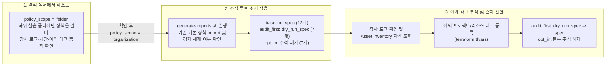

# GCP Organization 최소 보안 정책 (Minimal Org Policies)

새 GCP Organization을 만들거나 기존 조직의 보안을 정리할 때, 처음부터 수십 개의 조직 정책을 한꺼번에 강제(`spec`)로 걸어버리면 기존에 잘 돌던 배포 파이프라인이 막히거나 공개 버킷에서 `403` 에러가 나기 쉽습니다. 그렇다고 정책을 아예 비워두면 프로젝트를 만들 때마다 `Editor` 권한을 가진 기본 서비스 계정이나 `default` VPC가 그대로 생성됩니다.

이 코드는 실무에서 기본적으로 챙겨야 할 조직 정책 26개를 골라, 기존 워크로드에 주는 영향도에 따라 세 개의 정적(Static) Terraform 파일로 나누어 구성한 예제입니다. 복잡한 `dynamic` 루프 없이 파일만 열어보면 현재 어떤 정책이 켜져 있는지 바로 읽고 수정할 수 있습니다.

---

## 왜 세 개의 파일로 나누어 적용하나요?

정책마다 기존 리소스에 미치는 영향과 GCP API가 지원하는 기능(Dry-Run 여부 등)이 다르기 때문입니다.

| 파일 이름 | 수량 | 초기 상태 | 적용 기준 및 운영 방법 |
| :--- | :---: | :---: | :--- |
| [`baseline_policies.tf`](./baseline_policies.tf) | 12개 | `spec` (즉시 강제) | 기존 리소스를 건드리지 않거나 부작용이 없는 기본 보안 정책입니다. 신규 프로젝트의 `default` VPC 생성 생략, 기본 서비스 계정 자동 권한 차단, 유출 키 자동 비활성화, 도메인 제한(DRS), 신규 인스턴스에만 적용되는 Cloud SQL 공인 IP 차단 등이 포함됩니다. |
| [`audit_first_policies.tf`](./audit_first_policies.tf) | 7개 | `dry_run_spec` (감사) | GCP에서 네이티브 Dry-Run을 지원하는 `.managed.` 정책입니다. 처음에는 실제 차단 없이 Cloud Audit Logs에 위반 내역만 기록하고, 확인이 끝난 정책부터 블록 이름을 `dry_run_spec`에서 `spec`으로 바꿔 실제 차단으로 전환합니다. |
| [`opt_in_policies.tf`](./opt_in_policies.tf) | 7개 | `/* ... */` (주석) | API에서 Dry-Run을 지원하지 않거나 소급 차단 위험이 있는 레거시 스토리지·서버리스 네트워크 정책입니다. 기존 리소스를 먼저 점검하고 예외 태그를 붙인 뒤, 준비된 블록만 주석을 풀어서 적용합니다. |

> **참고**: `gcp.resourceLocations`(리전 제한)나 `gcp.restrictServiceUsage`(API 제한)처럼 글로벌 엔드포인트나 신규 서비스 테스트를 과도하게 막아 초기 운영에 불편을 주는 정책은 제외했습니다.



### 예외 처리는 어떻게 하나요? (`exempt-*` 태그)

정책을 운영하다 보면 외부 SaaS 연동을 위해 서비스 계정 키가 꼭 필요한 프로젝트나, 대외 공개용 정적 파일 버킷이 있는 프로젝트처럼 예외를 두어야 할 때가 있습니다. 이 코드는 하위 프로젝트에서 정책을 덮어쓰는 대신, 조직에서 관리하는 **Resource Manager 태그(`exempt-*=true`)** 가 붙은 경우에만 예외를 허용합니다.

- **태그 키를 8개로 나눈 이유**: GCP에서는 같은 TagKey 아래의 값 두 개를 한 프로젝트에 동시에 붙일 수 없습니다(`HTTP 400` 충돌). 한 프로젝트에서 서비스 계정 키 예외(`exempt-sa-key=true`)와 서버리스 예외(`exempt-serverless=true`)가 동시에 필요할 때도 문제없이 조합할 수 있도록 용도별로 태그 키를 분리했습니다.
- **프로젝트 태그 vs 개별 리소스 태그**: 프로젝트나 폴더에 붙인 태그(`project_tag_exemptions`)는 모든 정책에서 상속되어 동작합니다. 반면 Cloud Run 서비스나 VM에 직접 붙인 태그(`regional_resource_tag_exemptions`)는 `.managed.` 정책에서만 인식되며, `storage.publicAccessPrevention`이나 `run.allowedIngress` 같은 레거시 정책에서는 동작하지 않습니다. 따라서 레거시 정책 예외는 반드시 프로젝트(또는 폴더) 단위로 붙여야 합니다.

---

## 파일 구성 및 정책 목록

```text
minimal-org-policies/
├── versions.tf                # Terraform(>= 1.17.0) 및 Google Provider(~> 8.0) 설정
├── variables.tf               # 적용 범위(폴더/조직), 도메인·이미지 파라미터, 예외 태그 변수
├── main.tf                    # 정책 부착 경로(policy_parent), 태그 조건식, 실습/환경 폴더
├── tags.tf                    # 8종 예외 태그(TagKey/TagValue) 및 프로젝트·리소스 태그 바인딩
├── baseline_policies.tf       # 즉시 강제(spec)하는 기본 보안 정책 12개
├── audit_first_policies.tf    # 감사 모드(dry_run_spec)로 시작하는 .managed. 정책 7개
├── opt_in_policies.tf         # 주석을 풀어 선택 적용하는 정책 7개 + 타 조직 반입 정책 1개
├── outputs.tf                 # 정책 부착 경로, 실습 폴더 ID, 생성된 예외 태그 정보 출력
├── terraform.tfvars.example   # 변수 입력 예시 파일
└── scripts/
    └── generate-imports.sh    # 기존 기본 정책 import 파일 생성 및 설정 충돌 점검 스크립트
```

전체 정책 목록과 연결된 예외 태그 키는 다음과 같습니다.

| 구분 | 제약조건 이름 (`constraints/` 제외) | 초기 상태 | 예외 키 (`exempt-*`) | 태그 인식 범위 | 비고 |
| :--- | :--- | :---: | :---: | :---: | :--- |
| **Baseline** | `iam.managed.allowedPolicyMembers` | `spec` | `public_iam` | 프로젝트·리소스 | 차세대 도메인 제한 (`organizations/<ORG_ID>` 기준) |
| Baseline | `iam.automaticIamGrantsForDefaultServiceAccounts` | `spec` | - | - | 신규 생성 프로젝트의 기본 SA `Editor` 자동 부여 차단 |
| Baseline | `iam.serviceAccountKeyExposureResponse` | `spec` | - | - | 공개 저장소 등에 유출된 SA 키 감지 시 자동 비활성화 |
| Baseline | `compute.managed.disableSerialPortAccess` | `spec` | - | - | VM 직렬 포트 접근 차단 |
| Baseline | `compute.skipDefaultNetworkCreation` | `spec` | - | - | 신규 프로젝트 생성 시 `default` VPC 자동 생성 생략 |
| Baseline | `compute.disableVpcExternalIpv6` | `spec` | - | - | VPC 외부 IPv6 비활성화 |
| Baseline | `compute.restrictXpnProjectLienRemoval` | `spec` | - | - | Shared VPC 호스트 프로젝트 삭제 방지 잠금(Lien) 보호 |
| Baseline | `sql.managed.restrictPublicIp` | `spec` | `public_sql` | 프로젝트·인스턴스 | 신규 설정부터 적용 (기존 공인 IP 인스턴스는 유지됨) |
| Baseline | `sql.managed.restrictAuthorizedNetworks` | `spec` | `public_sql` | 프로젝트·인스턴스 | 신규 설정부터 적용 |
| Baseline | `compute.setNewProjectDefaultToZonalDNSOnly` | `spec` | - | - | 신규 프로젝트 내부 DNS 기본값을 Zonal DNS로 설정 |
| Baseline | `essentialcontacts.managed.allowedContactDomains` | `spec` | - | - | 중요 보안·장애 알림 수신 이메일 도메인 제한 |
| Baseline | `compute.managed.disableNestedVirtualization` | `spec` | - | - | VM 중첩 가상화 비활성화 |
| **Audit-First** | `iam.managed.disableServiceAccountKeyCreation` | `dry_run_spec` | `sa_key` | 프로젝트 | 2024년 5월 이후 생성된 조직은 이미 강제 중일 수 있음 |
| Audit-First | `iam.managed.disableServiceAccountKeyUpload` | `dry_run_spec` | `sa_key` | 프로젝트 | 외부 생성 공개키 업로드 감사 후 차단 |
| Audit-First | `compute.managed.requireOsLogin` | `dry_run_spec` | `os_login` | 프로젝트·VM | 메타데이터 SSH 키 사용 여부 확인 후 OS Login 전환 |
| Audit-First | `compute.managed.trustedImageProjects` | `dry_run_spec`* | `trusted_image` | 프로젝트·디스크 | (Preview) `trusted_image_projects` 변수 입력 시 생성 |
| Audit-First | `compute.managed.restrictProtocolForwardingCreationForTypes` | `dry_run_spec` | `external_ip` | 프로젝트·포워딩룰 | `INTERNAL` 포워딩만 허용 |
| Audit-First | `compute.managed.vmExternalIpAccess` | `dry_run_spec` | `external_ip` | 프로젝트·VM | VM 외부 공인 IP 차단 (개별 VM 단위 태그 예외 가능) |
| Audit-First | `run.managed.requireInvokerIam` | `dry_run_spec` | `serverless` | 프로젝트·서비스 | 무인증(`--no-invoker-iam-check`) Cloud Run 배포 확인 후 차단 |
| **Opt-In** | `storage.publicAccessPrevention` | 주석 | `public_storage` | 프로젝트·폴더만 | **소급 적용됨** — 공개 버킷 프로젝트에 태그 먼저 부착 필수 |
| Opt-In | `storage.uniformBucketLevelAccess` | 주석 | `public_storage` | 프로젝트·폴더만 | 신규 버킷에 균일한 버킷 수준 액세스(UBLA) 강제 |
| Opt-In | `run.allowedIngress` | 주석 | `serverless` | 프로젝트·폴더만 | 내부 및 Cloud Load Balancing 경유 트래픽만 허용 |
| Opt-In | `run.allowedVPCEgress` | 주석 | `serverless` | 프로젝트·폴더만 | Cloud Run VPC Egress 경유 강제 |
| Opt-In | `cloudfunctions.allowedIngressSettings` | 주석 | `serverless` | 프로젝트·폴더만 | Cloud Functions (1세대) 인그레스 제한 |
| Opt-In | `cloudfunctions.allowedVpcConnectorEgressSettings` | 주석 | `serverless` | 프로젝트·폴더만 | Cloud Functions (1세대) VPC 커넥터 이그레스 제한 |
| Opt-In | `cloudfunctions.requireVPCConnector` | 주석 | `serverless` | 프로젝트·폴더만 | Cloud Functions (1세대) VPC 커넥터 연결 필수화 |
| **이관용 (선택)** | `resourcemanager.allowedImportSources` | 조건부 생성 | - | - | `allowed_import_source_org_ids` 입력 시에만 생성 |

> **참고 ([`iam/multi-org-group-iam`](../multi-org-group-iam)과 함께 사용할 때)**: 신규 조직 안에 그룹을 만들고 기존 도메인 사용자를 멤버로 넣는 방식을 쓰면 모든 IAM 권한이 신규 조직 그룹에 부여되므로 `drs_allowed_org_ids`는 빈 리스트(`[]`)로 두어도 됩니다. 다만 다른 조직 소속 서비스 계정이나 그룹을 현재 조직 리소스 IAM에 직접 등록해야 한다면 해당 조직 ID를 `drs_allowed_org_ids`에 추가하세요.

---

## 사전 준비 사항

실행에는 **Terraform `v1.17.0` 이상**과 `gcloud` CLI가 필요하며, 실행 계정(또는 Impersonation 대상 서비스 계정)에 조직 레벨에서 아래 권한이 있어야 합니다.

- `roles/orgpolicy.policyAdmin` (조직/폴더 정책 생성 및 수정)
- `roles/resourcemanager.tagAdmin` (`exempt-*` 태그 키 및 값 생성)
- `roles/resourcemanager.tagUser` (프로젝트 및 리소스에 예외 태그 부착 — 개별 Cloud Run 서비스나 VM에 직접 태그를 붙일 때는 해당 리소스의 태그 바인딩 권한도 함께 필요)
- `roles/resourcemanager.folderAdmin` (실습용 폴더 또는 환경 폴더 생성 시)
- `roles/browser` (`project_tag_exemptions`에서 프로젝트 번호를 조회할 때 필요)

[`iam/multi-org-group-iam`](../multi-org-group-iam) 예제에서 만든 Seed 프로젝트(`iam-seed-prod-01`)와 `tf-iam-admin` 서비스 계정을 그대로 이어서 쓴다면 아래 명령으로 API와 권한만 추가하면 됩니다.

```bash
ORG_ID="123456789012"
SEED_PROJECT_ID="iam-seed-prod-01"
TF_SA_EMAIL="tf-iam-admin@${SEED_PROJECT_ID}.iam.gserviceaccount.com"

gcloud services enable \
  orgpolicy.googleapis.com \
  cloudresourcemanager.googleapis.com \
  --project="${SEED_PROJECT_ID}"

for ROLE in \
  roles/orgpolicy.policyAdmin \
  roles/resourcemanager.tagAdmin \
  roles/resourcemanager.tagUser \
  roles/resourcemanager.folderAdmin \
  roles/browser; do
  gcloud organizations add-iam-policy-binding "${ORG_ID}" \
    --member="serviceAccount:${TF_SA_EMAIL}" \
    --role="${ROLE}" \
    --condition=None
done
```

---

## 따라하기: 격리 폴더에서 먼저 테스트하기

조직 루트에 바로 적용하기 부담스럽다면 `policy_scope = "folder"`로 시작해 보세요. `policy-handson-lab`이라는 별도 폴더가 만들어지고 그 폴더 안에만 정책이 걸리기 때문에, 다른 운영 프로젝트에는 아무 영향을 주지 않고 동작을 확인할 수 있습니다.

### 1단계. 실습 폴더에 정책 배포

```bash
gcloud auth application-default login
cp terraform.tfvars.example terraform.tfvars
```

`terraform.tfvars` 파일을 열어 조직 ID와 도메인을 본인 환경에 맞게 수정합니다.

```hcl
org_id                      = "123456789012"
policy_scope                = "folder"
handson_folder_display_name = "policy-handson-lab"

allowed_contact_domains = [
  "@example.com",
]
```

여러 개의 `.managed.` 정책을 동시에 만들 때 Org Policy API에서 동시 변경 잠금(`409 CONCURRENT_POLICY_CHANGES`)이 걸리지 않도록 `-parallelism=2` 옵션을 붙여 실행합니다.

```bash
terraform init
terraform plan
terraform apply -parallelism=2

# 만들어진 실습 폴더 ID 확인
HANDSON_FOLDER=$(terraform output -raw handson_folder_id)
gcloud org-policies list --folder="${HANDSON_FOLDER#folders/}"
```

### 2단계. `dry_run_spec` 감사 로그 확인

실습 폴더(`policy-handson-lab`) 아래에 테스트용 프로젝트를 하나 넣은 뒤, 인증 검사를 끈 내부용 Cloud Run 서비스(`--no-invoker-iam-check`)를 배포해 봅니다. `run.managed.requireInvokerIam` 정책이 `dry_run_spec` 상태이므로 배포는 막히지 않고 성공하며, 약 10~30초 뒤 감사 로그에 위반 기록이 남습니다.

```bash
TEST_PROJECT_ID="<실습_폴더_하위_테스트_프로젝트_ID>"

gcloud services enable run.googleapis.com --project="${TEST_PROJECT_ID}"

gcloud run deploy policy-handson-svc \
  --project="${TEST_PROJECT_ID}" \
  --image="us-docker.pkg.dev/cloudrun/container/hello" \
  --region="asia-northeast3" \
  --ingress="internal" \
  --no-invoker-iam-check \
  --quiet

# 잠시 뒤 감사 로그 확인 (liveResult=ALLOWED, dryRunResult=DENIED 표시)
gcloud logging read \
  'log_id("cloudaudit.googleapis.com/policy") AND protoPayload.metadata."@type"="type.googleapis.com/google.cloud.audit.OrgPolicyDryRunAuditMetadata" AND protoPayload.metadata.dryRunResult="DENIED"' \
  --project="${TEST_PROJECT_ID}" \
  --freshness=10m \
  --format="table(timestamp, protoPayload.metadata.constraint, protoPayload.metadata.liveResult, protoPayload.metadata.dryRunResult, protoPayload.resourceName)"
```

### 3단계. `spec`으로 바꿔 실제 차단 확인

이번에는 [`audit_first_policies.tf`](./audit_first_policies.tf) 맨 아래에 있는 `run_require_invoker_iam` 블록에서 `dry_run_spec`을 `spec`으로 바꾸고 다시 적용해 봅니다.

```hcl
# audit_first_policies.tf (A-07)
resource "google_org_policy_policy" "run_require_invoker_iam" {
  name   = "${local.policy_parent}/policies/run.managed.requireInvokerIam"
  parent = local.policy_parent

  spec { # <- dry_run_spec 에서 spec 으로 변경
    # ...
  }
}
```

```bash
terraform apply -parallelism=2

# 똑같은 명령으로 다시 배포해 보면 조직 정책 위반(403)으로 바로 차단됩니다.
gcloud run deploy policy-handson-svc-blocked \
  --project="${TEST_PROJECT_ID}" \
  --image="us-docker.pkg.dev/cloudrun/container/hello" \
  --region="asia-northeast3" \
  --ingress="internal" \
  --no-invoker-iam-check \
  --quiet
```

### 4단계. 예외 태그를 붙여 조건부 허용 확인

이 프로젝트가 공개 웹훅을 받아야 하는 예외 대상이라고 가정하고, `terraform.tfvars`의 `project_tag_exemptions`에 프로젝트를 등록합니다.

```hcl
project_tag_exemptions = {
  "<실습_폴더_하위_테스트_프로젝트_ID>" = ["serverless"]
}
```

```bash
terraform apply -parallelism=2

# 태그 바인딩이 반영된 뒤(약 10~30초) 다시 실행하면 정상 배포됩니다.
gcloud run deploy policy-handson-svc-blocked \
  --project="${TEST_PROJECT_ID}" \
  --image="us-docker.pkg.dev/cloudrun/container/hello" \
  --region="asia-northeast3" \
  --ingress="internal" \
  --no-invoker-iam-check \
  --quiet

# 테스트용 서비스 삭제
gcloud run services delete policy-handson-svc policy-handson-svc-blocked \
  --project="${TEST_PROJECT_ID}" \
  --region="asia-northeast3" \
  --quiet
```

---

## 실제 Organization 루트에 적용하기

폴더 테스트가 끝났으면 아래 순서대로 Organization 전체에 적용합니다.

### 1. 기존 기본 정책 Import 및 강제 해제 여부 확인

2024년 5월 이후에 만들어진 GCP Organization에는 `iam.managed.disableServiceAccountKeyCreation` 등 일부 보안 정책이 처음부터 강제(`spec`) 상태로 들어가 있습니다. 그대로 `apply`를 실행하면 이미 존재하는 정책이라 `409` 에러가 나거나, 원래 강제 중이던 정책이 `dry_run_spec`으로 풀릴 수 있으므로 먼저 아래 스크립트를 실행합니다.

1. `terraform.tfvars`에서 `policy_scope = "organization"`으로 바꾸고, 앞서 테스트하며 수정했던 [`audit_first_policies.tf`](./audit_first_policies.tf) 내용이 있다면 원래대로 돌려놓습니다.
2. `generate-imports.sh` 스크립트를 실행해 현재 조직에 설정된 정책을 확인하고 `imports.tf` 파일을 생성합니다.
   ```bash
   # 로컬 ADC 계정 사용 시
   ./scripts/generate-imports.sh --org 123456789012

   # 서비스 계정 Impersonation 사용 시
   ./scripts/generate-imports.sh --org 123456789012 \
     --impersonate-sa tf-iam-admin@iam-seed-prod-01.iam.gserviceaccount.com \
     --billing-project iam-seed-prod-01
   ```
3. 스크립트 출력 메시지를 확인합니다.
   - 이미 강제 중인 정책이 `dry_run_spec`으로 바뀐다는 경고가 나오면, 안내된 대로 [`audit_first_policies.tf`](./audit_first_policies.tf)에서 해당 리소스의 `dry_run_spec`을 `spec`으로 바꿔 기존 강제 상태를 유지합니다.
   - `iam.allowedPolicyMemberDomains` 같은 예전 레거시 정책이 함께 켜져 있다는 안내가 나오면, `.managed.` 정책 적용 후 중복 차단이 일어나지 않도록 레거시 정책 정리를 검토합니다.
4. 변경 내역을 확인하고 배포합니다. (`imports.tf`는 `.gitignore`에 등록되어 있어 Git에는 올라가지 않습니다.)
   ```bash
   terraform plan
   terraform apply -parallelism=2
   ```

### 2. 기존 리소스 점검 및 단계적 전환

1~2주 정도 운영하며 감사 로그(아래 섹션 참고)를 확인하고, [`opt_in_policies.tf`](./opt_in_policies.tf)의 정책을 켜기 전에는 Cloud Asset Inventory로 기존 공개 버킷이나 외부 노출 리소스가 있는지 먼저 살펴봅니다.

```bash
ORG_ID="123456789012"

# 공개(allUsers / allAuthenticatedUsers) 권한이 열려 있는 GCS 버킷 조회
gcloud asset search-all-iam-policies \
  --scope="organizations/${ORG_ID}" \
  --query="policy:(allUsers OR allAuthenticatedUsers) resource://storage.googleapis.com"

# 외부 공인 IP가 붙어 있는 Compute Engine VM 조회
gcloud asset search-all-resources \
  --scope="organizations/${ORG_ID}" \
  --asset-types="compute.googleapis.com/Instance" \
  --query="externalIPs:*"

# Cloud Run 서비스 목록 조회
gcloud asset search-all-resources \
  --scope="organizations/${ORG_ID}" \
  --asset-types="run.googleapis.com/Service"
```

> [!WARNING]
> **`storage.publicAccessPrevention` 활성화 시 주의사항**
> 이 정책은 켜는 즉시 **기존에 운영 중이던 공개 버킷의 외부 읽기 요청까지 바로 차단(`403`)** 합니다. 또한 레거시 정책이라 개별 버킷에 붙인 태그는 인식하지 않으므로, 의도된 공개 버킷이 있다면 반드시 **그 버킷이 속한 프로젝트(`project_tag_exemptions`)나 상위 폴더**에 `public_storage` 태그를 먼저 적용한 뒤 [`opt_in_policies.tf`](./opt_in_policies.tf)의 주석을 해제하세요.

예외 등록과 정책 활성화 예시:

```hcl
# terraform.tfvars
project_tag_exemptions = {
  "public-web-assets-prod"   = ["public_storage"]
  "legacy-partner-sync-prod" = ["sa_key"]
}

# 개별 서비스 리소스에만 예외를 줄 때 (.managed. 정책 전용)
regional_resource_tag_exemptions = [
  {
    parent    = "//run.googleapis.com/projects/my-app-prod/locations/asia-northeast3/services/public-webhook"
    location  = "asia-northeast3"
    exemption = "serverless"
  }
]
```

태그를 먼저 적용(`terraform apply -parallelism=2`)한 뒤, 준비된 정책은 [`audit_first_policies.tf`](./audit_first_policies.tf)에서 `dry_run_spec`을 `spec`으로 바꾸거나 [`opt_in_policies.tf`](./opt_in_policies.tf)에서 해당 블록의 `/* ... */` 주석을 지우고 다시 `apply` 하면 됩니다.

> **참고 (타 조직에서 프로젝트를 이관해 올 때)**: `terraform.tfvars`의 `allowed_import_source_org_ids = ["<원본_ORG_ID>"]`에 원본 조직 ID를 넣으면 `resourcemanager.allowedImportSources` 정책이 활성화됩니다. 이관을 내보내는 원본 조직에서도 `resourcemanager.allowedExportDestinations`와 (Shared VPC 포함 이관 시) `resourcemanager.allowEnabledServicesForExport = ["SHARED_VPC"]`가 함께 열려 있어야 합니다. 이관이 끝나면 빈 리스트(`[]`)로 되돌려 두는 것이 안전합니다.

---

## Dry-Run 감사 로그 조회하기

`dry_run_spec`으로 동작하는 정책에 걸리는 API 호출이 발생하면 요청 자체는 통과(`liveResult: "ALLOWED"`)되지만, **호출이 일어난 하위 프로젝트의 `_Default` 로그 버킷**에 Policy 감사 로그(`dryRunResult: "DENIED"`)가 남습니다. 조직 루트만 조회하면 보이지 않으므로 프로젝트 단위로 조회하거나 통합 Log Sink로 모아서 확인합니다.

### 1. 개별 프로젝트에서 바로 조회하기

Cloud Console의 **Logging > Logs Explorer**에서 조회할 프로젝트를 선택하고 아래 필터를 입력합니다.

```text
log_id("cloudaudit.googleapis.com/policy")
protoPayload.metadata."@type"="type.googleapis.com/google.cloud.audit.OrgPolicyDryRunAuditMetadata"
protoPayload.metadata.dryRunResult="DENIED"
```

터미널에서 `gcloud`로 확인하려면 아래 명령을 실행합니다.

```bash
PROJECT_ID="<조회할_프로젝트_ID>"

gcloud logging read \
  'log_id("cloudaudit.googleapis.com/policy") AND protoPayload.metadata."@type"="type.googleapis.com/google.cloud.audit.OrgPolicyDryRunAuditMetadata" AND protoPayload.metadata.dryRunResult="DENIED"' \
  --project="${PROJECT_ID}" \
  --freshness=14d \
  --limit=50 \
  --format="table(timestamp, protoPayload.metadata.constraint:label=CONSTRAINT, protoPayload.authenticationInfo.principalEmail:label=PRINCIPAL, protoPayload.methodName:label=METHOD, protoPayload.resourceName:label=RESOURCE)"
```

### 2. 전체 프로젝트를 돌며 한 번에 조회하기

프로젝트가 많지 않을 때는 별도 Sink 구성 없이 아래 스크립트로 활성 프로젝트 전체의 최근 14일 위반 기록을 훑어볼 수 있습니다.

```bash
# 특정 폴더 하위만 볼 때: FILTER="parent.id=<FOLDER_ID> AND lifecycleState:ACTIVE"
FILTER="lifecycleState:ACTIVE"

for PROJECT_ID in $(gcloud projects list --filter="${FILTER}" --format="value(projectId)"); do
  RESULT=$(gcloud logging read \
    'log_id("cloudaudit.googleapis.com/policy") AND protoPayload.metadata."@type"="type.googleapis.com/google.cloud.audit.OrgPolicyDryRunAuditMetadata" AND protoPayload.metadata.dryRunResult="DENIED"' \
    --project="${PROJECT_ID}" \
    --freshness=14d \
    --limit=20 \
    --format="csv[no-heading](timestamp,protoPayload.metadata.constraint,protoPayload.authenticationInfo.principalEmail,protoPayload.resourceName)" 2>/dev/null)

  if [[ -n "${RESULT}" ]]; then
    echo "=== [${PROJECT_ID}] ==="
    echo "${RESULT}" | column -t -s ','
    echo ""
  fi
done
```

### 3. 조직 통합 Log Sink로 모아서 SQL로 집계하기 (운영 권장)

프로젝트 수가 많다면 조직 레벨 Aggregated Sink(`--include-children`)를 하나 만들어 중앙 프로젝트 로그 버킷으로 모으는 편이 관리하기 수월합니다.

```bash
ORG_ID="123456789012"
CENTRAL_LOG_PROJECT="iam-seed-prod-01"

gcloud logging buckets create org-policy-dryrun-bucket \
  --project="${CENTRAL_LOG_PROJECT}" \
  --location="global" \
  --retention-days=90 \
  --enable-analytics

gcloud logging sinks create org-policy-dryrun-sink \
  "logging.googleapis.com/projects/${CENTRAL_LOG_PROJECT}/locations/global/buckets/org-policy-dryrun-bucket" \
  --organization="${ORG_ID}" \
  --include-children \
  --log-filter='logName:"logs/cloudaudit.googleapis.com%2Fpolicy" AND protoPayload.metadata."@type"="type.googleapis.com/google.cloud.audit.OrgPolicyDryRunAuditMetadata"'

WRITER_IDENTITY=$(gcloud logging sinks describe org-policy-dryrun-sink --organization="${ORG_ID}" --format="value(writerIdentity)")
gcloud projects add-iam-policy-binding "${CENTRAL_LOG_PROJECT}" \
  --member="${WRITER_IDENTITY}" \
  --role="roles/logging.bucketWriter"
```

이후 **Logging > Log Analytics**에서 프로젝트·정책·호출 주체별 건수를 집계할 수 있습니다.

```sql
SELECT
  resource.labels.project_id AS project_id,
  JSON_VALUE(proto_payload.audit_log.metadata.constraint) AS violated_constraint,
  proto_payload.audit_log.authentication_info.principal_email AS caller_principal,
  proto_payload.audit_log.method_name AS api_method,
  COUNT(*) AS violation_count,
  MAX(timestamp) AS last_seen_at
FROM
  `iam-seed-prod-01.global.org-policy-dryrun-bucket._AllLogs`
WHERE
  timestamp >= TIMESTAMP_SUB(CURRENT_TIMESTAMP(), INTERVAL 14 DAY)
  AND JSON_VALUE(proto_payload.audit_log.metadata.dryRunResult) = "DENIED"
GROUP BY
  project_id, violated_constraint, caller_principal, api_method
ORDER BY
  violation_count DESC;
```

---

## 리소스 정리 및 자주 겪는 오류

폴더 실습 환경을 지울 때는 먼저 `policy-handson-lab` 폴더 안에 넣어둔 테스트 프로젝트를 밖으로 옮기거나 삭제한 뒤 `terraform destroy -parallelism=2`를 실행하세요. 또한 콘솔이나 `gcloud`로 직접 붙여둔 `exempt-*` 태그 바인딩이 남아 있으면 태그 삭제가 거부되므로 수동 바인딩을 먼저 해제해야 합니다.

| 오류 메시지 / 증상 | 원인 및 해결 방법 |
| :--- | :--- |
| `Error 409: Creating policy failed ... CONCURRENT_POLICY_CHANGES` | 같은 폴더나 조직에 여러 `.managed.` 정책을 동시에 생성·수정할 때 Org Policy API 동시성 잠금이 걸린 경우입니다. `terraform apply -parallelism=2`로 실행하세요. 이미 일부 생성된 상태에서 그대로 다시 실행하면 빠진 정책만 마저 만들어집니다. |
| `Error 409: Requested entity already exists` (`policies/...`) | 조직 생성 시 기본으로 들어간 정책이나 수동으로 만든 정책이 이미 있는 경우입니다. `./scripts/generate-imports.sh --org <ORG_ID>`를 실행해 `imports.tf`를 만든 뒤 다시 적용하세요. |
| 예외 태그를 붙였는데도 계속 차단됨 | 조직에 예전 레거시 제약조건(예: `iam.disableServiceAccountKeyCreation`, `iam.allowedPolicyMemberDomains`, `compute.vmExternalIpAccess`)이 별도로 켜져 있어 태그 조건 없이 막고 있는 경우가 많습니다. `gcloud org-policies list --organization=<ORG_ID>`로 확인 후 중복된 레거시 정책을 정리하세요. |
| 버킷에 태그를 붙였는데 `storage.publicAccessPrevention`에서 `403` 발생 | 레거시 제약조건은 버킷에 직접 붙인 태그를 읽지 못합니다. 버킷이 속한 프로젝트(`project_tag_exemptions`)나 상위 폴더에 `public_storage` 태그를 붙여야 합니다. |
| `Error 409: TagKey ... already exists` | 같은 조직 안에 동일한 이름(`exempt-*`)의 태그 키가 이미 있을 때 발생합니다. 공유 테스트 조직이라면 `tag_key_prefix = "lab-exempt"`처럼 접두어를 바꾸거나 기존 태그를 import해서 사용하세요. |
| `trusted_image_projects` 설정 시 `INVALID_ARGUMENT` | `projects/debian-cloud`처럼 문자열 프로젝트 ID를 넣었을 때 발생합니다. `compute.managed.trustedImageProjects`는 `projects/136693071363`처럼 **숫자형 프로젝트 번호**를 입력해야 합니다. (`gcloud projects describe debian-cloud --format="value(projectNumber)"`로 확인 가능) |
