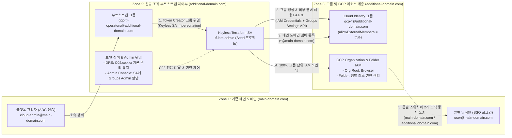
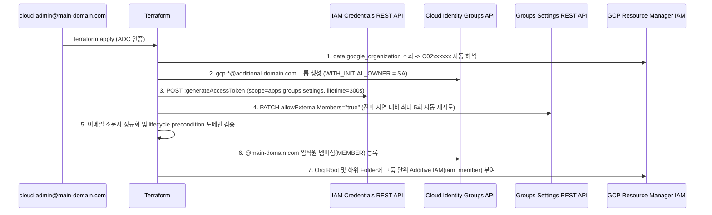

# Multi-Org Cloud Identity Group & GCP IAM Automation (Single SSO Login)

단일 로그인 메인 도메인(`user@main-domain.com`)을 그대로 유지하면서, 신규 분리된 GCP Organization(`additional-domain.com`)의 **Cloud Identity 그룹 생성 · 외부 도메인 멤버 매핑 · GCP IAM 권한 바인딩**을 **Keyless Service Account Impersonation + Terraform**으로 자동화하는 고객 환경 셋업 실습 가이드 및 코드 에셋입니다.

---

## 1. 배경 및 아키텍처 개요

### 1.1 대상 시나리오 및 수동 콘솔 운영의 한계

자회사 분사, 신규 사업부 독립, 규제·컴플라이언스 분리 등의 이유로 별도의 GCP Organization(`additional-domain.com`)을 추가 구축할 때 다음과 같은 요구사항과 제약이 발생합니다.

1. **단일 SSO 로그인 고정**: 전 임직원은 기존 IdP(Okta, Microsoft Entra ID 등)와 연동된 **`user@main-domain.com`** 계정 하나로만 Google Cloud에 로그인합니다.
2. **Cloud Identity 자체 그룹 관리**: 외부 IdP의 그룹 SCIM 동기화를 사용하지 않고, 신규 조직의 Cloud Identity 디렉터리에서 직접 그룹 및 GCP IAM 권한을 제어합니다.
3. **2개 GCP Organization 동시 노출**: 권한이 부여된 임직원이 GCP Console에 로그인하면 상단 **Organization Switcher(조직 선택 드롭다운)** 에 기존 `main-domain.com`과 신규 `additional-domain.com` 두 조직이 나란히 표시되어 계정 전환 없이 즉시 이동할 수 있어야 합니다.
4. **수동 콘솔 UI 운영의 제약**: `user@main-domain.com`은 `additional-domain.com` 조직 기준 **외부 도메인 계정(External Member)** 이므로, GCP Console UI(`IAM & Admin > Groups`)에서 직접 신규 그룹을 생성하거나 편집하는 작업이 차단됩니다.

> [!IMPORTANT]
> **핵심 해결 원칙 (Keyless SA Impersonation + DRS 무변경 격리 아키텍처)**
> - **100% 신규 조직 그룹 단위 IAM 바인딩**: 부트스트랩 SA 가장 권한(`Token Creator`)부터 조직·폴더 권한까지 모든 GCP IAM 바인딩 주체를 **신규 조직 소속 그룹(`group:gcp-*@additional-domain.com`)** 으로 통일하고, **그룹의 멤버**만 기존 메인 로그인 계정(`*@main-domain.com`)으로 등록합니다.
> - **DRS(Domain Restricted Sharing) 기본 격리 100% 유지**: 모든 IAM 바인딩 주체가 `additional-domain.com`(`C02xxxxxx`) 소속 그룹이므로 신규 조직의 DRS 정책에 `main-domain.com`(`C01xxxxxx`)을 추가할 필요가 없습니다. 실수로 `@main-domain.com` 개인 계정을 신규 조직 리소스에 직접 바인딩하려는 시도는 DRS가 서버 측에서 차단합니다.
> - **Break-glass 봉인 및 Keyless 운영**: `superadmin@additional-domain.com` 계정은 초기 1회 부트스트랩(Step 1~2) 후 물리 MFA를 적용해 봉인하고, 일상 운영은 JSON 키 발급 없이 **Keyless Service Account Impersonation**과 Terraform으로만 수행합니다.

---

### 1.2 예시 도메인 및 환경 식별자 매핑

본 가이드와 Terraform 템플릿은 아래 예시 도메인 및 식별자를 기준으로 작성되어 있습니다. 실습 진행 시 고객사의 실제 값으로 치환하여 사용하세요.

| 구분 | 가이드 예시 값 | 실제 고객사 적용 값 (예시) | 설명 |
| :--- | :--- | :--- | :--- |
| **기존 메인 로그인 도메인** | **`main-domain.com`** | 고객사 본사/통합 SSO 도메인 | 전 임직원이 IdP SSO로 로그인하는 단일 도메인 |
| **신규 GCP 조직 도메인** | **`additional-domain.com`** | 신규 분리 조직 도메인 | 추가 구축한 독립 GCP Organization 도메인 |
| **신규 조직 GCP Org ID** | `123456789012` | 12자리 숫자형 ID | `additional-domain.com`의 GCP Organization ID |
| **신규 조직 Customer ID** | `C02xxxxxx` | `C`로 시작하는 9자리 ID | `additional-domain.com`의 Cloud Identity Directory Customer ID |
| **비상용 Super Admin** | `superadmin@additional-domain.com` | 신규 조직 최고 관리자 | Step 1~2 초기 부트스트랩 **1회만 사용 후 봉인** |
| **일상 운영 관리자 (IaC)** | `cloud-admin@main-domain.com` | 클라우드 플랫폼 관리자 | 일상 로그인 및 `terraform apply`를 실행하는 메인 도메인 계정 |
| **일반 사용자 (개발자)** | `app-dev1@main-domain.com` | 서비스 개발자 계정 | 단일 로그인으로 두 조직을 전환하며 업무를 수행하는 계정 |
| **부트스트랩 운영자 그룹** | `gcp-tf-operators@additional-domain.com` | Step 1~2에서 1회 생성 | `tf-iam-admin` SA에 대한 `Token Creator` 권한을 보유한 그룹 |
| **Seed 프로젝트 ID** | `iam-seed-prod-01` | 고객사 네이밍 규칙 적용 | 신규 조직 내 Terraform SA 호스팅 및 API 쿼터 프로젝트 |
| **Keyless Terraform SA** | `tf-iam-admin@iam-seed-prod-01.iam.gserviceaccount.com` | Seed 프로젝트 소속 SA | `Groups Admin` + `Org/Folder Admin` 권한을 위임받는 자동화 전용 SA |

---

### 1.3 End-to-End 아키텍처 흐름



---

### 1.4 아키텍처 선택 가이드 (신규 조직 독립 그룹 vs 메인 도메인 그룹 직접 바인딩)

고객사의 조직 분리 목적(규제·분사 거버넌스 분리 vs 단순 환경 분리)에 따라 아래 두 가지 패턴 중 적합한 아키텍처를 선택할 수 있습니다. 본 에셋은 **패턴 A**를 자동화합니다.

| 비교 항목 | 패턴 A: 신규 조직 독립 그룹 (본 에셋) | 패턴 B: 메인 도메인 그룹 직접 바인딩 (단순화 대안) |
| :--- | :--- | :--- |
| **IAM 바인딩 주체** | `group:gcp-*@additional-domain.com` (멤버만 `*@main-domain.com`) | `group:*@main-domain.com`을 신규 조직 리소스에 직접 바인딩 |
| **신규 조직 DRS 정책** | **`C02xxxxxx` 단독 허용 유지** (`C01` 개인 계정 직접 바인딩 원천 차단) | DRS에 **`C01xxxxxx` 추가 허용 필수** (`C01` 소속 개인 계정 직접 바인딩도 기술적으로 허용됨) |
| **그룹 수명주기 및 관리 주체** | 신규 조직의 Terraform SA가 독립 소유 (향후 분사·매각 시 본사 의존성 없음) | 본사(`main-domain.com`) Google Workspace / IdP 관리팀에 종속 |
| **구성 복잡도** | 중간 (Admin Console `Groups Admin` 위임 + Groups Settings API `PATCH`) | 낮음 (외부 멤버 허용 및 Groups Settings API 불필요) |
| **권장 고객 시나리오** | 자회사 분사·규제 분리 조직, 또는 본사 디렉터리 관리 권한 없이 클라우드팀이 신규 조직 IAM을 독립 운영해야 하는 경우 | 두 조직이 영구적으로 동일 본사 IT 거버넌스 아래 있고 본사 디렉터리에서 모든 그룹을 통합 관리하는 경우 |

---

## 2. 프로젝트 디렉터리 구조

```text
multi-org-group-iam/
├── README.md                  # 고객 환경 셋업 실습 가이드 (본 문서)
├── versions.tf                # Terraform / Google Provider 버전, SA Impersonation 및 GCS Backend 예시
├── variables.tf               # 조직 ID, 도메인, Seed 프로젝트, 그룹/역할 스키마 및 입력값 검증 규칙
├── main.tf                    # Customer ID 자동 조회, 대소문자 정규화, 그룹 생성, 외부 멤버 허용 PATCH 및 IAM 바인딩
├── outputs.tf                 # 조회된 Directory Customer ID, 생성된 그룹 이메일 및 샘플 폴더 ID 출력
└── terraform.tfvars.example   # main-domain.com / additional-domain.com 기준 변수 템플릿
```

---

## 3. 권장 Cloud Identity 그룹 체계 및 Multi-Org IAM 매트릭스

개인 계정(`user:*@main-domain.com`)에 직접 GCP IAM 역할을 부여하지 않고, 부트스트랩부터 일상 운영까지 **100% 신규 조직 소속 그룹(`group:gcp-*@additional-domain.com`) 단위로만 바인딩**합니다.

| 권장 그룹 (`@additional-domain.com`) | 생성 방식 | IAM 바인딩 범위 | 핵심 GCP IAM 역할 | 소속 멤버 (`@main-domain.com`) 및 목적 |
| :--- | :--- | :--- | :--- | :--- |
| **`gcp-tf-operators@additional-domain.com`** | Step 1~2 부트스트랩 (1회) | `tf-iam-admin` **Service Account** | `roles/iam.serviceAccountTokenCreator` | IaC 실행 플랫폼 관리자 — **DRS에 `C01`을 열지 않고** Keyless SA Impersonation 수행 |
| **`gcp-users@additional-domain.com`** *(필수)* | Terraform | `additional-domain.com` **Org Root** | `roles/browser` | 신규 조직 접근 대상 전 임직원 — `resourcemanager.organizations.get` 포함으로 **콘솔 조직 스위처에 두 조직 동시 표시** 및 폴더/프로젝트 계층 트리 탐색 |
| **`gcp-org-admins@additional-domain.com`** | Terraform | `additional-domain.com` **Org Root** | `roles/resourcemanager.organizationAdmin`<br>`roles/resourcemanager.folderAdmin`<br>`roles/resourcemanager.projectCreator` | 클라우드 플랫폼 관리팀 — 폴더 계층 구조, 프로젝트 생성 및 조직 IAM 총괄 |
| **`gcp-net-admins@additional-domain.com`** *(확장)* | Terraform | Shared VPC Folder / Host Project | `roles/compute.networkAdmin`<br>`roles/compute.xpnAdmin` | 네트워크·보안팀 — Shared VPC, 방화벽, 하이브리드 연결 중앙 제어 |
| **`gcp-app-devs@additional-domain.com`** | Terraform | `app-dev` **Folder** / Project | `roles/resourcemanager.folderViewer`<br>`roles/viewer` *(또는 GKE 등 최소 권한)* | 서비스 개발팀 — 담당 환경 폴더 및 하위 프로젝트 리소스만 격리 접근 |
| **`gcp-billing@additional-domain.com`** *(확장)* | Terraform | Billing Account & Org Root | `roles/billing.admin` 또는 `roles/billing.viewer` | FinOps·재무팀 — 신규 조직 빌링 계정 비용 모니터링 및 예산 관리 |

> [!TIP]
> **`gcp-users` 그룹의 계층 노출 범위 조정 옵션**: `roles/browser`를 Org Root에 부여하면 콘솔에서 전체 폴더·프로젝트 트리를 편리하게 탐색할 수 있는 대신, 타 팀 프로젝트의 존재(목록)와 프로젝트 IAM 정책(`resourcemanager.projects.getIamPolicy`)까지 조회할 수 있습니다. 만약 타 팀 프로젝트 목록 노출까지 차단하고 상단 **Organization Switcher 노출만** 허용하려면 `gcp-users`의 `org_roles`를 `["roles/resourcemanager.organizationViewer"]`로 변경하세요.

---

## 4. Step-by-Step 환경 셋업 실습 가이드

### Step 0. 사전 준비 및 Before 상태 확인

1. **로컬 실습 도구 확인**:
   - [Terraform](https://developer.hashicorp.com/terraform/downloads) `v1.5.0` 이상 (`google` 프로바이더 `>= 6.0.0`)
   - Google Cloud SDK (`gcloud`), `curl`, `python3` 설치
2. **Before 상태 확인 (`user@main-domain.com` 브라우저)**:
   - 크롬 브라우저에서 `cloud-admin@main-domain.com`(또는 `app-dev1@main-domain.com`)으로 `https://console.cloud.google.com` 에 로그인합니다.
   - 상단 리소스 셀렉터의 조직 드롭다운을 열었을 때, 현재는 **`main-domain.com` 1개만 표시되고 `additional-domain.com`은 보이지 않는 상태**임을 확인합니다.

---

### Step 1. 초기 부트스트랩 (1/2) — GCP Seed 프로젝트, Keyless SA 및 부트스트랩 그룹 생성

> [!NOTE]
> Step 1과 Step 2는 신규 조직 구축 시 비상용 최고 관리자(**`superadmin@additional-domain.com`**)로 **최초 1회만 수행**합니다.

#### 1-1. 신규 조직 ID, Customer ID 및 Billing Account 조회

```bash
# 1. 신규 조직의 비상용 Super Admin 계정으로 로그인
gcloud auth login superadmin@additional-domain.com

# 2. additional-domain.com의 숫자형 ORG_ID 및 C0... 형식 DIRECTORY_CUSTOMER_ID 확인
gcloud organizations list

# 3. Seed 프로젝트에 연결할 Billing Account ID 확인
gcloud billing accounts list
```

**실행 출력 예시:**

```text
$ gcloud organizations list
DISPLAY_NAME           ID            DIRECTORY_CUSTOMER_ID
additional-domain.com  123456789012  C02xxxxxx

$ gcloud billing accounts list
ACCOUNT_ID            NAME                        OPEN  MASTER_ACCOUNT_ID
01XXXX-XXXXXX-XXXXXX  Enterprise Billing Account  True
```

> [!WARNING]
> `ID`(`123456789012`, 숫자형 GCP Organization ID)와 `DIRECTORY_CUSTOMER_ID`(`C02xxxxxx`, Cloud Identity 고객 ID)는 서로 다른 식별자입니다. Cloud Identity Groups API의 `parent`에는 반드시 `C02xxxxxx` 형식이 사용되어야 하며, 본 에셋의 Terraform 코드는 `additional_org_id`만 입력하면 `C02xxxxxx`를 자동 조회합니다.

#### 1-2. 환경 변수 설정, Seed 프로젝트 생성 및 필수 API 6종 활성화

```bash
export ADDITIONAL_DOMAIN="additional-domain.com" # 신규 분리 GCP 조직 도메인
export ADDITIONAL_ORG_ID="123456789012"          # additional-domain.com의 숫자형 ORG_ID
export ADDITIONAL_CUSTOMER_ID="C02xxxxxx"        # additional-domain.com의 DIRECTORY_CUSTOMER_ID
export BILLING_ID="01XXXX-XXXXXX-XXXXXX"         # 연결할 Billing Account ID
export SEED_PROJECT_ID="iam-seed-prod-01"        # 신규 조직 내 부트스트랩 프로젝트 ID

# 1. Seed 프로젝트 생성 및 빌링 연결
gcloud projects create "${SEED_PROJECT_ID}" --organization="${ADDITIONAL_ORG_ID}"
gcloud billing projects link "${SEED_PROJECT_ID}" --billing-account="${BILLING_ID}"
gcloud config set project "${SEED_PROJECT_ID}"

# 2. 필수 API 6종 활성화 (orgpolicy.googleapis.com은 Step 1-5의 DRS 정책 조회 쿼터용으로 포함)
gcloud services enable \
  cloudidentity.googleapis.com \
  groupssettings.googleapis.com \
  cloudresourcemanager.googleapis.com \
  orgpolicy.googleapis.com \
  iam.googleapis.com \
  iamcredentials.googleapis.com \
  --project="${SEED_PROJECT_ID}"
```

#### 1-3. Keyless Terraform Service Account 생성

```bash
# 3. Terraform 자동화 전용 Service Account 생성 (JSON 키 발급 없음)
gcloud iam service-accounts create tf-iam-admin \
  --display-name="Terraform Group and IAM Automation SA" \
  --project="${SEED_PROJECT_ID}"

export TF_SA_EMAIL="tf-iam-admin@${SEED_PROJECT_ID}.iam.gserviceaccount.com"

# Step 2의 Google Admin Console 등록에 사용할 SA 이메일 및 Unique ID 확인
gcloud iam service-accounts describe "${TF_SA_EMAIL}" --format="table(email,uniqueId)"
```

**실행 출력 예시:**

```text
EMAIL                                                  UNIQUE_ID
tf-iam-admin@iam-seed-prod-01.iam.gserviceaccount.com  110722989422038000000
```

#### 1-4. Terraform SA에 최소 권한(조직/폴더 관리 및 Seed 쿼터 권한) 부여

```bash
# 4. Terraform SA에 신규 Organization 레벨 IAM 및 Folder 관리 최소 권한 부여
for ROLE in \
  roles/resourcemanager.organizationAdmin \
  roles/resourcemanager.folderAdmin; do
  gcloud organizations add-iam-policy-binding "${ADDITIONAL_ORG_ID}" \
    --member="serviceAccount:${TF_SA_EMAIL}" \
    --role="${ROLE}" \
    --condition=None
done

# 5. Terraform SA가 Seed 프로젝트를 API Quota Project로 사용할 수 있도록 허용 (필수!)
gcloud projects add-iam-policy-binding "${SEED_PROJECT_ID}" \
  --member="serviceAccount:${TF_SA_EMAIL}" \
  --role="roles/serviceusage.serviceUsageConsumer"
```

#### 1-5. 부트스트랩 운영자 그룹(`gcp-tf-operators`) 생성 및 그룹 단위 SA Impersonation 허용

2024년 5월 3일 이후 생성된 신규 GCP 조직(2024년 2~4월 생성된 일부 조직 포함)은 보안 기준 제약(Security Baseline Constraints)에 의해 기본적으로 `iam.allowedPolicyMemberDomains`(Domain Restricted Sharing, DRS) 조직 정책이 적용되어 자기 자신의 도메인(`C02xxxxxx`)만 IAM 주체로 허용합니다 *(그 이전에 생성된 조직은 DRS가 비활성 상태일 수 있으므로 `gcloud org-policies describe iam.allowedPolicyMemberDomains --organization="${ADDITIONAL_ORG_ID}"`로 정책 적용 여부를 확인하세요)*.

DRS는 IAM 바인딩에 **직접 명시된 주체**의 소속 도메인만 검사하고 그룹 내부 멤버는 검사하지 않습니다. 따라서 개인 계정(`user:cloud-admin@main-domain.com`) 대신 신규 조직 소속 그룹(**`group:gcp-tf-operators@additional-domain.com`**)을 생성해 `roles/iam.serviceAccountTokenCreator`를 부여하면, **DRS 정책에 `main-domain.com`(`C01xxxxxx`)을 추가하지 않고 `C02xxxxxx` 전용 격리 상태를 그대로 유지**할 수 있습니다.

```bash
export TF_OPERATOR_GROUP="gcp-tf-operators@${ADDITIONAL_DOMAIN}"

# 6. 신규 조직(C02xxxxxx) 내 부트스트랩 운영자 그룹 생성
gcloud identity groups create "${TF_OPERATOR_GROUP}" \
  --customer="${ADDITIONAL_CUSTOMER_ID}" \
  --display-name="GCP Terraform Operators" \
  --description="Bootstrap group allowed to impersonate tf-iam-admin Service Account" \
  --billing-project="${SEED_PROJECT_ID}"

# 7. 신규 조직 그룹 단위로 Keyless SA Impersonation(Token Creator) 권한 부여 (DRS 수정 불필요!)
gcloud iam service-accounts add-iam-policy-binding "${TF_SA_EMAIL}" \
  --member="group:${TF_OPERATOR_GROUP}" \
  --role="roles/iam.serviceAccountTokenCreator" \
  --project="${SEED_PROJECT_ID}"
```

#### Step 1 GCP Console 교차 검증 포인트

| 검증 항목 | GCP Console 확인 경로 | 정상 설정 확인 기준 |
| :--- | :--- | :--- |
| **Keyless SA 상태** | Seed 프로젝트(`iam-seed-prod-01`) > `IAM & Admin > Service accounts` | `tf-iam-admin@...` 상태 `Enabled`, **`Key ID: No keys`** (발급된 키 없음) |
| **신규 조직 SA 최소 권한** | 조직(`additional-domain.com`) > `IAM & Admin > IAM` (`tf-iam-admin` 필터) | `Folder Admin`, `Organization Administrator` 2개 역할만 최소 권한으로 부여됨 |
| **Seed 쿼터 권한** | Seed 프로젝트(`iam-seed-prod-01`) > `IAM & Admin > IAM` | `tf-iam-admin@...`에 **`Service Usage Consumer`** 역할 직접 부여 확인 |
| **DRS 기본 격리 유지** | 조직(`additional-domain.com`) > `IAM & Admin > Organization policies` > `Domain restricted sharing` | `C01` 추가 없이 기본 `is:C02xxxxxx`(`additional-domain.com`) 격리 상태 유지 |
| **그룹 단위 SA 가장 권한** | Seed 프로젝트 > `Service accounts` > `tf-iam-admin` > **`Principals with access`** 탭 | **`gcp-tf-operators@additional-domain.com`** 그룹에 **`Service Account Token Creator`** 부여 확인 |

---

### Step 2. 초기 부트스트랩 (2/2) — Google Admin Console 1회 설정

`superadmin@additional-domain.com` 계정으로 **`https://admin.google.com`** 에 접속하여 아래 **3가지**를 설정한 뒤 로그아웃합니다.

1. **Terraform Service Account에 `Groups Admin` 역할 직접 할당 (Domain-Wide Delegation 불필요)**
   - 좌측 메뉴 **Account(계정) > Admin roles(관리자 역할)** 이동
   - **Groups Admin(그룹 관리자)** 선택 → **Admins(관리자)** 클릭 → **`Assign service accounts`(서비스 계정 할당)** 클릭
   - Step 1-3에서 생성한 `tf-iam-admin@iam-seed-prod-01.iam.gserviceaccount.com` 입력 후 **Assign role** 클릭
   - **확인 기준**: `Admins` 목록에 `tf-iam-admin@...` (`Organizational unit: All organizational units`, `Type: Service account`)가 표시되어야 합니다.
2. **조직 전체에서 그룹 소유자의 외부 도메인 멤버 추가 허용**
   - 좌측 메뉴 **Apps(앱) > Google Workspace > Groups for Business** 이동
     - *(참고: `Service status`가 `OFF`인 경우 `ON for everyone`으로 먼저 변경)*
   - **Sharing settings(공유 설정) > Sharing options** 클릭
   - **`Allow group owners to add external members` (그룹 소유자가 외부 회원을 허용할 수 있음)** 체크박스를 **체크(ON)** → 우측 하단 **Save** 클릭
3. **부트스트랩 그룹(`gcp-tf-operators`)에 외부 멤버 허용 및 운영 관리자(`cloud-admin@main-domain.com`) 등록**
   - 좌측 메뉴 **Directory(디렉터리) > Groups(그룹)** → Step 1-5에서 생성한 **`gcp-tf-operators@additional-domain.com`** 클릭
   - **Access settings(액세스 설정)** 클릭 → **`Allow external members`(외부 회원 허용)** 토글을 **ON** 으로 변경 후 **Save** 클릭
   - **Members(회원) > Add members(회원 추가)** 클릭 → `cloud-admin@main-domain.com` 입력 후 역할은 **`Member`** 로 유지한 채 **Add to group** 클릭 *(권한 우회를 막기 위해 `Owner`/`Manager`는 부여하지 않습니다)*
4. **전파 대기 및 Super Admin 봉인**:
   - 그룹 멤버십 및 Admin 역할이 GCP IAM에 반영될 때까지 **약 1~5분간 전파 시간**을 대기한 뒤, `superadmin@additional-domain.com` 세션에서 완전히 로그아웃합니다. 이후 일상 운영에서는 더 이상 이 계정에 로그인하지 않습니다.

---

### Step 3. 단일 로그인 계정(`cloud-admin@main-domain.com`)으로 전환

이제부터 모든 인프라 및 그룹/IAM 운영은 메인 SSO 도메인 계정인 `cloud-admin@main-domain.com`으로만 수행합니다. 로컬 터미널의 `gcloud` CLI 인증과 Terraform ADC(Application Default Credentials) 인증을 모두 전환합니다.

```bash
# 1. gcloud CLI 활성 계정을 메인 도메인 관리자로 전환
gcloud auth login cloud-admin@main-domain.com

# 2. Terraform Provider 및 local-exec(IAM Credentials API 호출)가 사용할 ADC 로그인
gcloud auth application-default login

# 3. 현재 활성 계정이 @main-domain.com인지 확인
gcloud auth list --filter=status:ACTIVE --format="value(account)"
```

---

### Step 4. Terraform 변수 설정 및 자동 배포 (`init` → `plan` → `apply`)

#### 4-1. `terraform.tfvars` 작성

[`terraform.tfvars.example`](./terraform.tfvars.example) 파일을 복사하여 `terraform.tfvars`를 생성하고 실제 환경 값을 입력합니다 (`*.tfvars`는 `.gitignore`에 의해 Git 커밋에서 제외됩니다).

```bash
cp terraform.tfvars.example terraform.tfvars
```

```hcl
additional_org_id        = "123456789012" # additional-domain.com의 숫자형 GCP ORG_ID
# additional_customer_id = "C02xxxxxx"    # (선택) 생략 시 additional_org_id로부터 자동 조회
additional_domain        = "additional-domain.com"
main_login_domain        = "main-domain.com"
seed_project_id          = "iam-seed-prod-01"
tf_service_account_email = "tf-iam-admin@iam-seed-prod-01.iam.gserviceaccount.com"

create_sample_folder       = true
sample_folder_display_name = "app-dev"

groups = {
  users = {
    email_prefix = "gcp-users"
    display_name = "GCP All Users"
    description  = "Grants Browser role so additional-domain.com appears in GCP Organization Switcher and hierarchy tree"
    members = [
      "cloud-admin@main-domain.com",
      "app-dev1@main-domain.com",
    ]
    org_roles = [
      "roles/browser",
    ]
  }

  org_admins = {
    email_prefix = "gcp-org-admins"
    display_name = "GCP Organization Admins"
    description  = "Platform and Organization Administrators for additional-domain.com (managed strictly via Terraform)"
    members      = ["cloud-admin@main-domain.com"]
    org_roles = [
      "roles/resourcemanager.organizationAdmin",
      "roles/resourcemanager.folderAdmin",
      "roles/resourcemanager.projectCreator",
    ]
  }

  dev_team = {
    email_prefix = "gcp-app-devs"
    display_name = "GCP App Developers (Dev)"
    description  = "Application developers scoped to the app-dev folder"
    members      = ["app-dev1@main-domain.com"]
    folder_roles = [
      "roles/resourcemanager.folderViewer",
      "roles/viewer",
    ]
  }
}
```

#### 4-2. Terraform 배포 실행

```bash
terraform init
terraform plan
terraform apply
```

#### 4-3. Terraform 내부 4단계 자동화 파이프라인 ([`main.tf`](./main.tf))



1. **Directory Customer ID 자동 해석 (`data.google_organization.additional`)**: 숫자형 `additional_org_id`로부터 `C02xxxxxx` ID를 자동 조회하여 `parent` 입력 실수로 인한 `Error 400`을 방지합니다.
2. **그룹 생성 및 SA 단독 Owner 등록 (`google_cloud_identity_group`)**: `initial_group_config = "WITH_INITIAL_OWNER"` 옵션으로 그룹 생성과 동시에 `tf-iam-admin` SA만 유일한 그룹 Owner로 지정합니다.
3. **IAM Credentials API 기반 외부 멤버 허용 자동 활성화 (`terraform_data.enable_external_members`)**: 공식 **IAM Credentials REST API (`:generateAccessToken`)** 를 호출해 300초 수명의 `apps.groups.settings` 스코프 SA 토큰을 메모리 내에서만 발급받아(State 파일 미저장), **Groups Settings API (`PATCH /groups/v1/groups/{email}?alt=json`)** 로 `allowExternalMembers = true`를 자동 설정합니다.
4. **이메일 소문자 정규화, 도메인 검증 및 Additive IAM 바인딩**: `members`/`managers` 이메일을 소문자·공백 정규화(`lower(trimspace(...))`)하여 대소문자 혼용 충돌을 막고, `@main-domain.com` 외 도메인 오입력을 `precondition`으로 차단한 뒤 `iam_member` 리소스로 권한을 증분 부여합니다.

---

### Step 5. 배포 후 검증 시나리오 (체크리스트)

`terraform apply` 완료 후 신규 그룹 멤버십이 GCP IAM 캐시에 전파되기까지 **약 1~5분(수 분)** 이 소요될 수 있습니다. 아래 순서로 정상 동작을 검증합니다.

#### 5-A. Google Admin Console 검증 *(초기 검증 시에만 확인)*

| 확인 위치 | 정상 동작 확인 포인트 |
| :--- | :--- |
| `admin.google.com` > **Directory > Groups** | 부트스트랩 그룹(`gcp-tf-operators@`) 외에 Terraform으로 생성한 `gcp-users@`, `gcp-org-admins@`, `gcp-app-devs@additional-domain.com` 그룹이 표시되며 **외부 멤버 허용 배지** 활성화 확인 |
| **Terraform 생성 그룹** 클릭 > **Members** | `tf-iam-admin@...` 서비스 계정만 유일한 **`Owner` (`Service account`)** 로 유지되고, `*@main-domain.com` 임직원 계정은 모두 **`Member` (`User`)** 로 편입됨 (`Manager` 미부여 확인) |
| **부트스트랩 그룹(`gcp-tf-operators@`)** > **Members** | 초기 생성자인 `superadmin@additional-domain.com`(봉인 계정)이 **`Owner`** 로 표시되고, `cloud-admin@main-domain.com`은 **`Member`** 로 표시됨 |

#### 5-B. GCP Console 검증 (`user@main-domain.com` 단일 로그인 상태)

| 검증 단계 | GCP Console 확인 경로 | 기대 결과 및 거버넌스 효과 |
| :--- | :--- | :--- |
| **① 2개 조직 동시 노출** | 상단 프로젝트/조직 선택 창 → **Organization 드롭다운** | **`main-domain.com`** 과 **`additional-domain.com`** 2개 조직이 나란히 표시되며 재로그인 없이 즉시 전환 가능 (`roles/browser` 내 `resourcemanager.organizations.get` 적용) |
| **② GCP 그룹 동기화** | `additional-domain.com` 전환 > **`IAM & Admin > Groups`** | Terraform으로 생성한 그룹 및 멤버 목록 정상 조회 |
| **③ 콘솔 UI 수동 변경 차단** | `IAM & Admin > Groups` > 그룹 생성 또는 수동 편집 시도 | `@main-domain.com` 외부 계정 및 `Member` 역할 사용자에게는 그룹 생성·멤버 편집 권한이 없으므로 GCP Console / Google Groups 웹 UI를 통한 우발적 수동 변경 차단 |
| **④ 폴더 최소 권한 격리** | `app-dev` 폴더 선택 > **`IAM & Admin > IAM`** | 개인 계정(`user:`) 직접 바인딩 없이 `group:gcp-app-devs@additional-domain.com` 그룹에만 `Folder Viewer` / `Viewer` 역할이 격리 부여됨 |

#### 5-C. Terraform 경로 비인가 외부 도메인(`@gmail.com`) 차단 테스트

`allowExternalMembers = true`가 켜져 있더라도 Terraform 코드 변경 시 비인가 외부 계정이 차단되는지 검증합니다.

1. `terraform.tfvars`의 아무 그룹 `members` 리스트에 `"unauthorized-user@gmail.com"`을 임시로 추가합니다.
2. `terraform plan`을 실행합니다.
3. 실제 API 호출 전에 Plan 단계에서 즉시 아래 에러와 함께 거부되는 것을 확인한 뒤 원복합니다.

```text
Error: Resource precondition failed

  on main.tf line 158, in resource "google_cloud_identity_group_membership" "external_domain_members":
 158:       condition     = endswith(each.value.member_email, "@${local.normalized_main_login_domain}")

보안 정책 위반: 허용된 메인 로그인 도메인(@main-domain.com) 계정만 그룹에 추가할 수 있습니다. (입력값: unauthorized-user@gmail.com)
```

---

## 5. 운영 보안 가드레일, 알려진 제약 및 프로덕션 전환 가이드

### 5.1 운영 보안 가드레일 및 기술적 제약 사항

1. **Terraform 배포 경로 도메인 검증 및 `MANAGER` 권한 배제**:
   - Terraform `lifecycle.precondition`은 **Terraform 코드 파이프라인 경로**에서의 비인가 도메인(`@gmail.com` 등) 오입력을 차단합니다. 단, Admin Console이나 Cloud Identity API를 통한 직접 변경(Out-of-band)까지 서버 측에서 차단하지는 못하며, Cloud Identity의 서버 측 `SecuritySettings.memberRestriction` 또한 현재 동일 조직(`groupCustomerId()`, 즉 `C02`) 제한만 지원하여 타 조직(`C01`) 허용 규칙에는 사용할 수 없습니다.
   - 따라서 고권한 그룹에 사람 계정을 `MANAGER`/`OWNER`로 지정하지 않아 `groups.google.com` 우회 추가 경로를 차단하고, 정기적인 멤버십 감사 점검을 병행해야 합니다.
2. **Tier-0 최상위 특권 그룹(`gcp-tf-operators`, `gcp-org-admins`) 최우선 감사 알림 설정**:
   - `tf-iam-admin` SA는 도메인 전체 `Groups Admin`과 GCP `organizationAdmin`을 함께 보유합니다. 따라서 SA 가장 권한을 가진 **`gcp-tf-operators@additional-domain.com`** 과 조직 IAM 정책 변경 권한(스스로 `Token Creator` 부여 가능)을 가진 **`gcp-org-admins@additional-domain.com`** 멤버는 사실상 신규 조직의 **최상위 권한(Tier-0)** 경로입니다.
   - 순환 잠금(Self-lockout)을 방지하기 위해 `gcp-tf-operators`는 의도적으로 Terraform 관리 대상에서 분리해 두었으나, SA가 `Groups Admin`이므로 기술적으로는 코드 변경을 통해 접근할 수도 있습니다. 반드시 Google Workspace **Admin 감사 로그(Groups Audit Log)** 및 **GCP Cloud Audit Logs**에서 이 두 그룹의 멤버십 변경과 `tf-iam-admin` SA의 IAM 정책 변경을 **최우선 실시간 보안 알림(Alert) 대상**으로 설정하세요.
3. **`allowExternalMembers` 설정의 Drift 미감지 한계**:
   - `hashicorp/google` 프로바이더가 Groups Settings 리소스를 네이티브 지원하지 않기 때문에 [`main.tf`](./main.tf)의 `terraform_data.enable_external_members`는 그룹 최초 생성(또는 교체) 시 1회 `PATCH`를 수행합니다(호스트 `ps` 프로세스 인자 노출을 막기 위해 `curl -K -` stdin 헤더 전달 방식 사용). 이후 누군가 Admin Console에서 수동으로 외부 멤버 허용을 끄더라도 `terraform plan` 단계에서는 변경(Drift)이 감지되지 않으며 신규 멤버 추가 시점에 API 에러로 나타납니다.
4. **100% Keyless 인증, DRS 기본 격리 유지 및 Additive IAM 준수**:
   - SA JSON 키 발급을 금지(`constraints/iam.disableServiceAccountKeyCreation`)하고, DRS는 `C02xxxxxx` 전용으로 유지하며, 조직 루트 Lock-out 사고를 막기 위해 기존 권한을 덮어쓰는 `iam_policy` / `iam_binding` 대신 증분 관리 리소스인 `google_organization_iam_member`와 `google_folder_iam_member`만 사용합니다.

### 5.2 프로덕션 운영 성숙도 전환 가이드 (GCS State & CI/CD WIF)

실습 완료 후 실제 프로덕션 환경으로 전환할 때는 아래 두 가지를 적용하여 **코드 리뷰를 통한 실질적인 이중 통제(Dual Control)** 를 완성하세요.

1. **원격 GCS State 백엔드 구성**:
   - Seed 프로젝트(`iam-seed-prod-01`) 내에 객체 버전 관리(Object Versioning)와 Uniform Bucket-Level Access가 활성화된 GCS 버킷을 생성하고, [`versions.tf`](./versions.tf)의 `backend "gcs"` 블록 주석을 해제하여 로컬 상태 파일 유실 및 동시 실행 충돌을 방지합니다.
2. **개인 로컬 ADC 대신 CI/CD Workload Identity Federation(WIF) 전환 (이중 가장 주의)**:
   - 운영자 개인 노트북에서 `terraform apply`를 실행할 수 있으면 Git PR 리뷰를 우회할 여지가 남습니다. 프로덕션 전환 시 `gcp-tf-operators` 그룹에서 사람 계정을 제거(비상시 한시 투입)하고, GitHub Actions 또는 Cloud Build 파이프라인이 **`main` 브랜치 PR 승인 및 머지 시에만 `terraform apply`를 실행**하도록 전환하세요.
   - **WIF 구성 시 주의점 (1-hop Impersonation 유지)**: [`versions.tf`](./versions.tf)의 `impersonate_service_account`와 [`main.tf`](./main.tf)의 `local-exec`(`:generateAccessToken`)는 모두 **"호출자 ADC → `tf-iam-admin` SA 1단계 가장"** 구조로 동작합니다. 만약 CI 인증 스텝(예: `google-github-actions/auth`의 `service_account` 옵션)이나 로컬 `gcloud auth application-default login --impersonate-service-account`로 ADC 자체를 이미 SA가 가장된 상태로 만들면, SA가 자기 자신에 대해 `:generateAccessToken`을 다시 호출하면서 `HTTP 403`이 발생합니다.
     - **권장 구성**: WIF 주체(`principalSet://iam.googleapis.com/projects/.../workloadIdentityPools/...`)에 `tf-iam-admin` SA의 `roles/iam.serviceAccountTokenCreator`를 부여하고, CI 인증 단계에서는 SA 가장 옵션을 뺀 **Direct WIF**로 ADC를 구성하세요.
     - **대안 구성**: 조직 표준상 CI에서 SA 가장형 ADC(`service_account_impersonation_url` 포함)를 반드시 써야 한다면, `tf-iam-admin` SA에 자기 자신(`serviceAccount:${TF_SA_EMAIL}`)에 대한 `roles/iam.serviceAccountTokenCreator`를 추가 부여하면 정상 동작합니다.

---

## 6. 리소스 정리 (Teardown)

실습 또는 PoC 검증 완료 후 생성된 모든 GCP 리소스와 Google Admin Console 위임 설정을 완전히 원복하려면 아래 순서대로 정리합니다.

```bash
# 1. Terraform 관리 리소스(폴더, IAM 바인딩, 그룹 멤버십, Terraform 생성 그룹) 일괄 삭제
#    (cloud-admin@main-domain.com 인증 상태에서 실행)
terraform destroy

# 2. 초기 부트스트랩 리소스까지 완전히 제거하려면 Super Admin으로 전환
gcloud auth login superadmin@additional-domain.com

export ADDITIONAL_DOMAIN="additional-domain.com"
export ADDITIONAL_ORG_ID="123456789012"
export SEED_PROJECT_ID="iam-seed-prod-01"
export TF_SA_EMAIL="tf-iam-admin@${SEED_PROJECT_ID}.iam.gserviceaccount.com"
export TF_OPERATOR_GROUP="gcp-tf-operators@${ADDITIONAL_DOMAIN}"

# 3. 부트스트랩 운영자 그룹(gcp-tf-operators) 삭제
gcloud identity groups delete "${TF_OPERATOR_GROUP}" \
  --billing-project="${SEED_PROJECT_ID}" \
  --quiet

# 4. 조직 루트에 남아 있는 Terraform SA의 IAM 바인딩 제거 (deleted:serviceAccount 잔존 방지)
for ROLE in \
  roles/resourcemanager.organizationAdmin \
  roles/resourcemanager.folderAdmin; do
  gcloud organizations remove-iam-policy-binding "${ADDITIONAL_ORG_ID}" \
    --member="serviceAccount:${TF_SA_EMAIL}" \
    --role="${ROLE}" \
    --condition=None
done

# 5. Seed 프로젝트(내부 Terraform SA 및 Token Creator 바인딩 포함) 삭제
gcloud projects delete "${SEED_PROJECT_ID}" --quiet
```

6. **Google Admin Console (`https://admin.google.com`) 설정 원복**:
   - `Account > Admin roles > Groups Admin > Admins`에서 삭제된 `tf-iam-admin@...` 서비스 계정 할당 해제
   - 외부 도메인 그룹 멤버 기능이 더 이상 필요 없는 경우 `Apps > Google Workspace > Groups for Business > Sharing settings > Sharing options`에서 **`Allow group owners to add external members`** 체크 해제 후 **Save**

> [!TIP]
> 프로덕션 환경에서 샘플 폴더(`app-dev`)만 제거하고 그룹·조직 IAM 체계를 유지하려면 `terraform.tfvars`에서 `create_sample_folder = false`로 변경한 뒤 `terraform apply`를 실행하세요.

---

## 7. 트러블슈팅 플레이북 (Troubleshooting)

| 증상 / 주요 에러 메시지 | 발생 원인 | 해결 방법 (Remediation) |
| :--- | :--- | :--- |
| `Error 400: Invalid resource.parent` (creating Group) | 그룹 `parent` 필드에 `C0...` 형식의 Directory Customer ID 대신 숫자형 `ORG_ID`를 입력함 | `terraform.tfvars`에서 `additional_customer_id`를 생략(주석 처리)하여 `additional_org_id` 기반 자동 조회를 사용하거나 `C02xxxxxx` 값을 정확히 입력 |
| `Failed to generate short-lived SA token ... HTTP 403` (`iam.serviceAccounts.getAccessToken` denied) | `cloud-admin@main-domain.com`이 `gcp-tf-operators@additional-domain.com` 그룹에 추가되지 않았거나 그룹 멤버십 IAM 전파 지연 | Step 2-3에서 `gcp-tf-operators` 그룹의 `Allow external members` ON 및 멤버 등록 여부를 확인하고 **1~5분 전파 대기** 후 재실행 |
| `Error 403: caller does not have required permission to use project ... USER_PROJECT_DENIED` | Terraform SA에 Seed 프로젝트의 쿼터 사용 권한이 없거나 IAM 바인딩 전파 지연 | Step 1-4의 `roles/serviceusage.serviceUsageConsumer` 바인딩을 Seed 프로젝트(`iam-seed-prod-01`)에 부여한 뒤 1~2분 후 재실행 |
| `Groups Settings API` 호출 시 `HTTP 403` 또는 외부 멤버(`@main-domain.com`) 추가 거부 | Google Admin Console에서 SA에 `Groups Admin`을 할당하지 않았거나 `Allow group owners to add external members` 미체크 | Step 2-1, 2-2의 `admin.google.com` 설정을 확인하고 1~5분 전파 대기 후 `terraform apply` 재실행 |
| 신규 조직 리소스에 `user:*@main-domain.com` 직접 바인딩 시도 시 `FAILED_PRECONDITION` (DRS 차단) | 신규 조직의 DRS 정책(`iam.allowedPolicyMemberDomains`)이 `C02xxxxxx` 도메인 주체만 허용하도록 정상 보호 중임 | 의도된 보안 동작입니다. 개인 계정 직접 바인딩 대신 `terraform.tfvars`의 신규 조직 그룹(`gcp-*@additional-domain.com`) 멤버로 추가하여 권한을 부여하세요 |
| `terraform apply` 성공 후에도 GCP Console 드롭다운에 `additional-domain.com`이 바로 안 보임 | 신규 그룹 멤버십 → GCP IAM 캐시 전파 지연(통상 1~5분) 또는 해당 계정이 `gcp-users` 그룹(`roles/browser`)에 누락됨 | 1~5분 대기 후 브라우저 강력 새로고침(`Ctrl+Shift+R` / `Cmd+Shift+R`) 또는 `gcloud organizations list`로 API 노출 여부 먼저 확인 |
