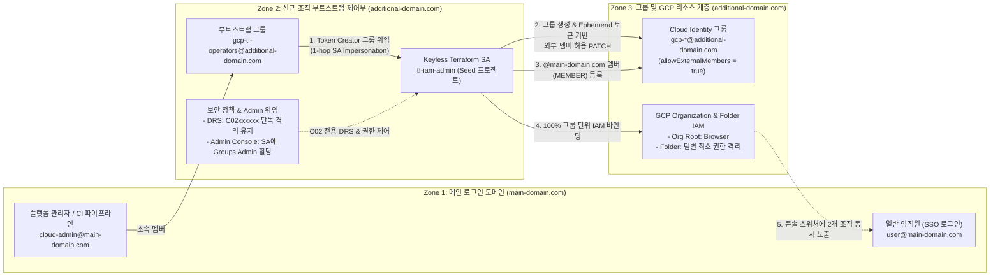
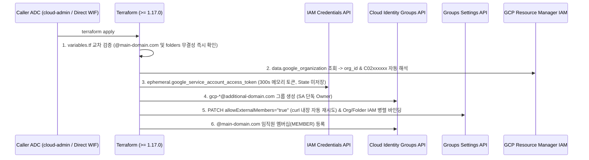

# Multi-Org Cloud Identity Group & GCP IAM Automation (Single SSO Login)

단일 로그인 메인 도메인(`user@main-domain.com`)을 그대로 유지하면서, 신규 분리된 GCP Organization(`additional-domain.com`)의 **Cloud Identity 그룹 생성 · 외부 도메인 멤버 매핑 · GCP IAM 권한 바인딩**을 **Keyless Service Account Impersonation + 최신 Terraform (`>= 1.17.0`)** 으로 자동화하는 실습 가이드 및 코드 에셋입니다.

---

## 1. 배경 및 아키텍처 개요

### 1.1 해결하려는 문제와 핵심 설계 원칙

자회사 분사, 신규 사업부 독립, 규제 분리 등으로 별도 GCP Organization(`additional-domain.com`)을 추가 구축할 때 흔히 다음 요구사항이 충돌합니다.

- **단일 SSO 로그인 유지**: 전 임직원은 기존 IdP와 연동된 **`user@main-domain.com`** 계정 하나로만 Google Cloud에 로그인하고, 콘솔 상단 **Organization Switcher**에서 두 조직을 즉시 오갈 수 있어야 합니다.
- **수동 UI 운영 및 DRS 제약**: `@main-domain.com`은 신규 조직 기준 외부 도메인 계정이므로 콘솔 `IAM & Admin > Groups` UI에서 직접 그룹을 생성·편집할 수 없으며, 신규 조직의 DRS(Domain Restricted Sharing) 정책은 기본적으로 자기 도메인(`C02xxxxxx`) 주체만 허용합니다.

> [!IMPORTANT]
> **핵심 아키텍처 (Keyless SA Impersonation + DRS 무변경 격리)**
> 1. **100% 신규 조직 그룹 단위 IAM 바인딩**: 부트스트랩 SA 가장 권한(`Token Creator`)부터 조직·폴더 권한까지 모든 GCP IAM 주체를 **`group:gcp-*@additional-domain.com`** 으로 통일하고, **그룹 내부 멤버(`MEMBER`)** 만 `*@main-domain.com`으로 등록합니다.
> 2. **DRS 기본 격리 100% 유지**: IAM 바인딩 주체가 모두 `additional-domain.com`(`C02xxxxxx`) 소속 그룹이므로 신규 조직 DRS에 `main-domain.com`(`C01xxxxxx`)을 열 필요가 없으며, `@main-domain.com` 개인 계정 직접 바인딩 실수는 DRS가 서버 측에서 원천 차단합니다.
> 3. **State 미저장 Ephemeral 단기 토큰 & Keyless 운영**: `superadmin@additional-domain.com`은 최초 부트스트랩(Step 1~2) 1회 후 봉인하고, 일상 운영은 SA JSON 키 없이 Terraform `ephemeral "google_service_account_access_token"`(메모리 전용 단기 토큰)과 Impersonation으로만 수행합니다.

### 1.2 End-to-End 아키텍처 흐름



### 1.3 아키텍처 패턴 선택 가이드

| 비교 항목 | 패턴 A: 신규 조직 독립 그룹 *(본 에셋)* | 패턴 B: 메인 도메인 그룹 직접 바인딩 *(단순화 대안)* |
| :--- | :--- | :--- |
| **IAM 바인딩 주체** | `group:gcp-*@additional-domain.com` (멤버만 `*@main-domain.com`) | `group:*@main-domain.com`을 신규 조직 리소스에 직접 바인딩 |
| **신규 조직 DRS 정책** | **`C02xxxxxx` 단독 허용 유지** (`C01` 개인 계정 직접 바인딩 원천 차단) | DRS에 **`C01xxxxxx` 추가 허용 필수** (`C01` 개인 계정 직접 바인딩도 열림) |
| **그룹 소유 및 수명주기** | 신규 조직 Terraform SA가 독립 소유 (분사·매각 시 본사 의존성 없음) | 본사(`main-domain.com`) Google Workspace / IdP 관리팀에 종속 |
| **권장 시나리오** | 자회사 분사·규제 분리 조직, 본사 디렉터리 권한 없이 독립 IAM 운영 필요 시 | 두 조직이 영구적으로 동일 본사 거버넌스 아래 통합 관리되는 경우 |

---

## 2. 디렉터리 구조 및 권장 그룹 매트릭스

```text
multi-org-group-iam/
├── README.md                  # 아키텍처 개요 및 Step-by-Step 환경 셋업 가이드
├── versions.tf                # Terraform(>= 1.17.0) / Google Provider(~> 8.0), Keyless SA Impersonation 설정
├── variables.tf               # 핵심 3개 환경 변수(도메인·SA), 선언형 폴더/그룹 스키마 및 교차 변수 검증 규칙
├── main.tf                    # Org/Customer ID 자동 조회, Ephemeral 토큰 발급, 그룹 생성·PATCH 및 IAM 바인딩
├── outputs.tf                 # 명시적 타입(type) 계약이 적용된 조직 메타데이터, 그룹 이메일, 폴더 ID 출력
└── terraform.tfvars.example   # main-domain.com / additional-domain.com 기준 간결한 변수 템플릿
```

| 권장 그룹 (`@additional-domain.com`) | 생성 방식 | 바인딩 범위 | 핵심 GCP IAM 역할 | 소속 멤버 (`@main-domain.com`) 및 목적 |
| :--- | :--- | :--- | :--- | :--- |
| **`gcp-tf-operators@`** | Step 1~2 (1회) | `tf-iam-admin` SA | `roles/iam.serviceAccountTokenCreator` | IaC 실행 관리자 — DRS에 `C01`을 열지 않고 Keyless SA Impersonation 수행 |
| **`gcp-users@`** *(필수)* | Terraform | Org Root | `roles/browser` | 신규 조직 접근 전 임직원 — **콘솔 조직 스위처에 두 조직 동시 표시** 및 트리 탐색 |
| **`gcp-org-admins@`** | Terraform | Org Root | `roles/resourcemanager.organizationAdmin`<br>`roles/resourcemanager.folderAdmin`<br>`roles/resourcemanager.projectCreator` | 클라우드 플랫폼 관리팀 — 폴더 계층 구조, 프로젝트 생성 및 조직 IAM 총괄 |
| **`gcp-app-devs@`** | Terraform | `app-dev` Folder | `roles/resourcemanager.folderViewer`<br>`roles/viewer` | 서비스 개발팀 — 담당 폴더 및 하위 프로젝트 리소스만 최소 권한 격리 접근 |

> [!TIP]
> 타 팀 프로젝트 목록 노출까지 차단하고 **상단 Organization Switcher 노출만** 허용하려면 `gcp-users`의 `org_roles`를 `["roles/resourcemanager.organizationViewer"]`로 변경하세요.

---

## 3. Step-by-Step 환경 셋업 실습 가이드

### Step 0. 사전 준비

- **필수 로컬 도구**:
  - [Terraform](https://developer.hashicorp.com/terraform/downloads) **`v1.17.0` 이상** (최신 `v1.17.1` 권장, `hashicorp/google ~> 8.0`)
  - Google Cloud SDK (`gcloud` — 초기 부트스트랩 및 로컬 ADC 로그인용), `curl` (`terraform apply` 런타임에는 `terraform`과 `curl`만 사용되며 `python3` 불필요)
- **Before 상태 확인**: `cloud-admin@main-domain.com`으로 GCP Console에 로그인했을 때 상단 조직 드롭다운에 `main-domain.com`만 보이고 `additional-domain.com`은 표시되지 않는 것을 확인합니다.

---

### Step 1. 초기 부트스트랩 (1/2) — Seed 프로젝트, Keyless SA 및 운영자 그룹 생성

> [!NOTE]
> Step 1~2는 신규 조직 구축 시 비상용 최고 관리자(**`superadmin@additional-domain.com`**)로 **최초 1회만 수행 후 봉인**합니다.

```bash
# 1. 비상용 Super Admin 로그인 및 식별자 확인
gcloud auth login superadmin@additional-domain.com
gcloud organizations list      # DISPLAY_NAME, ID(숫자형 ORG_ID), DIRECTORY_CUSTOMER_ID(C0...) 확인
gcloud billing accounts list   # 연결할 Billing Account ID 확인

# 2. 환경 변수 설정
export ADDITIONAL_DOMAIN="additional-domain.com"
export ADDITIONAL_ORG_ID="123456789012"
export ADDITIONAL_CUSTOMER_ID="C02xxxxxx"
export BILLING_ID="01XXXX-XXXXXX-XXXXXX"
export SEED_PROJECT_ID="iam-seed-prod-01"

# 3. Seed 프로젝트 생성, 빌링 연결 및 필수 API 6종 활성화
gcloud projects create "${SEED_PROJECT_ID}" --organization="${ADDITIONAL_ORG_ID}"
gcloud billing projects link "${SEED_PROJECT_ID}" --billing-account="${BILLING_ID}"
gcloud config set project "${SEED_PROJECT_ID}"

gcloud services enable \
  cloudidentity.googleapis.com \
  groupssettings.googleapis.com \
  cloudresourcemanager.googleapis.com \
  orgpolicy.googleapis.com \
  iam.googleapis.com \
  iamcredentials.googleapis.com \
  --project="${SEED_PROJECT_ID}"

# 4. Keyless Terraform Service Account 생성 (JSON 키 발급 없음) 및 최소 권한 부여
gcloud iam service-accounts create tf-iam-admin \
  --display-name="Terraform Group and IAM Automation SA" \
  --project="${SEED_PROJECT_ID}"

export TF_SA_EMAIL="tf-iam-admin@${SEED_PROJECT_ID}.iam.gserviceaccount.com"

for ROLE in \
  roles/resourcemanager.organizationAdmin \
  roles/resourcemanager.folderAdmin; do
  gcloud organizations add-iam-policy-binding "${ADDITIONAL_ORG_ID}" \
    --member="serviceAccount:${TF_SA_EMAIL}" \
    --role="${ROLE}" \
    --condition=None
done

gcloud projects add-iam-policy-binding "${SEED_PROJECT_ID}" \
  --member="serviceAccount:${TF_SA_EMAIL}" \
  --role="roles/serviceusage.serviceUsageConsumer"

# 5. 부트스트랩 운영자 그룹 생성 및 그룹 단위 SA Impersonation(Token Creator) 부여 (DRS 변경 불필요)
export TF_OPERATOR_GROUP="gcp-tf-operators@${ADDITIONAL_DOMAIN}"

gcloud identity groups create "${TF_OPERATOR_GROUP}" \
  --customer="${ADDITIONAL_CUSTOMER_ID}" \
  --display-name="GCP Terraform Operators" \
  --description="Bootstrap group allowed to impersonate tf-iam-admin Service Account" \
  --billing-project="${SEED_PROJECT_ID}"

gcloud iam service-accounts add-iam-policy-binding "${TF_SA_EMAIL}" \
  --member="group:${TF_OPERATOR_GROUP}" \
  --role="roles/iam.serviceAccountTokenCreator" \
  --project="${SEED_PROJECT_ID}"
```

---

### Step 2. 초기 부트스트랩 (2/2) — Google Admin Console 1회 설정

`superadmin@additional-domain.com`으로 **`https://admin.google.com`** 에 접속하여 아래 3가지를 설정한 뒤 로그아웃합니다.

1. **Terraform SA에 `Groups Admin` 할당 (Domain-Wide Delegation 불필요)**:
   - **Account > Admin roles > Groups Admin > Admins > Assign service accounts** 클릭 → `tf-iam-admin@iam-seed-prod-01.iam.gserviceaccount.com` 등록
2. **조직 내 그룹의 외부 멤버 허용 옵션 활성화**:
   - **Apps > Google Workspace > Groups for Business** (*OFF 상태면 `ON for everyone` 전환*) → **Sharing settings > Sharing options** → **`Allow group owners to add external members`** 체크 후 **Save**
3. **부트스트랩 그룹(`gcp-tf-operators`)에 외부 멤버 허용 및 운영자 등록**:
   - **Directory > Groups > `gcp-tf-operators@additional-domain.com`** 선택
   - **Access settings** → **`Allow external members`** **ON** 저장
   - **Members > Add members** → `cloud-admin@main-domain.com`을 **`Member`** 역할로 추가 (*`Owner`/`Manager` 부여 금지*)
4. **1~5분 IAM 전파 대기** 후 `superadmin@additional-domain.com` 세션에서 완전히 로그아웃합니다.

---

### Step 3. 단일 로그인 계정(`cloud-admin@main-domain.com`) 전환 및 Terraform 배포

이제부터 모든 일상 운영은 메인 SSO 도메인 계정으로만 수행합니다.

```bash
# 1. 메인 도메인 관리자 계정으로 ADC 인증 전환
gcloud auth login cloud-admin@main-domain.com
gcloud auth application-default login

# 2. 변수 파일 생성 (필수 입력값은 additional_domain, main_login_domain, tf_service_account_email 단 3개!)
cp terraform.tfvars.example terraform.tfvars
```

[`terraform.tfvars.example`](./terraform.tfvars.example)을 참고해 값을 수정한 뒤 배포합니다 (`org_id`, `directory_customer_id`, `billing_project`는 코드에서 자동 해석됩니다):

```bash
terraform init
terraform plan
terraform apply
```

#### Terraform 내부 자동화 흐름 ([`main.tf`](./main.tf))



---

### Step 4. 배포 후 검증 체크리스트

1. **콘솔 2개 조직 동시 노출**: `user@main-domain.com` 브라우저에서 상단 Organization 드롭다운을 열면 `main-domain.com`과 `additional-domain.com`이 나란히 노출되어 재로그인 없이 즉시 전환됩니다 *(초기 반영까지 1~5분 소요 가능)*.
2. **폴더 최소 권한 및 SA 단독 Owner 확인**:
   - `additional-domain.com` > `app-dev` 폴더 IAM에 개인 계정(`user:`) 없이 `group:gcp-app-devs@additional-domain.com`만 바인딩되어 있는지 확인합니다.
   - 그룹 내 모든 인간 사용자는 `MEMBER`로만 등록되며, 콘솔 UI에서 수동 그룹 생성·편집이 차단되는지 확인합니다.
3. **비인가 외부 도메인(`@gmail.com`) 즉시 차단 테스트**:
   - `terraform.tfvars`의 아무 그룹 `members`에 `"unauthorized-user@gmail.com"`을 임시로 넣고 `terraform plan`을 실행하면, API 호출 전에 즉시 아래 입력 검증 에러로 차단됩니다 (확인 후 원복).

```text
Error: Invalid value for variable
  on variables.tf line 27:
  27: variable "groups" {

보안 정책 위반: 모든 그룹 멤버는 허용된 메인 로그인 도메인(@main-domain.com) 계정이어야 합니다.
```

---

## 4. 운영 보안 가드레일 및 프로덕션 전환 가이드

1. **Tier-0 특권 그룹 감사 알림 및 Out-of-Band 방어**:
   - `variables.tf` 검증은 Terraform 파이프라인 경로의 비인가 도메인을 차단하며, 코드 구조상 인간에게 `MANAGER`를 부여하지 않아 `groups.google.com` 우회 초대를 막습니다.
   - 최상위 권한 경로인 **`gcp-tf-operators@`** 와 **`gcp-org-admins@`** 의 멤버십 변경 및 `tf-iam-admin` SA IAM 변경에 대해 Google Workspace Admin 감사 로그 및 Cloud Audit Logs 실시간 알림을 반드시 설정하세요.
   - `allowExternalMembers`는 프로바이더 네이티브 리소스 부재로 최초 생성 시 1회 `PATCH`되므로 Admin Console에서 수동 변경하지 않도록 주의하세요.
2. **원격 GCS State 백엔드 & CI/CD Direct WIF 전환**:
   - Seed 프로젝트 내 버전 관리가 활성화된 GCS 버킷을 생성하고 [`versions.tf`](./versions.tf)의 `backend "gcs"` 주석을 해제합니다.
   - 프로덕션에서는 GitHub Actions / Cloud Build의 **Direct WIF** 주체(`principalSet://...`)에 `tf-iam-admin` SA의 `roles/iam.serviceAccountTokenCreator`를 부여하세요. [`versions.tf`](./versions.tf)의 기본 프로바이더와 `google.caller` 별칭 프로바이더 모두 **1-hop Impersonation** 구조로 동작하며 `gcloud` CLI 없이도 CI 컨테이너에서 바로 실행됩니다 *(만약 CI 인증 스텝 자체에서 이미 SA 가장형 ADC를 생성하는 경우 `tf-iam-admin` SA 자기 자신에게 `Token Creator`를 추가 부여하면 2-hop 호출도 정상 동작합니다)*.
3. **하위 폴더 조정**: 프로덕션에서 샘플 폴더(`app-dev`)가 불필요하면 `terraform.tfvars`에서 `folders = []`로 비우고 `folder_roles` 매핑만 제거한 뒤 `terraform apply`를 실행하세요.

---

## 5. 리소스 정리 (Teardown)

```bash
# 1. Terraform 관리 리소스 일괄 삭제 (cloud-admin@main-domain.com 인증 상태)
terraform destroy

# 2. 초기 부트스트랩 리소스까지 완전히 정리할 경우 Super Admin으로 전환
gcloud auth login superadmin@additional-domain.com

export ADDITIONAL_DOMAIN="additional-domain.com"
export ADDITIONAL_ORG_ID="123456789012"
export SEED_PROJECT_ID="iam-seed-prod-01"
export TF_SA_EMAIL="tf-iam-admin@${SEED_PROJECT_ID}.iam.gserviceaccount.com"
export TF_OPERATOR_GROUP="gcp-tf-operators@${ADDITIONAL_DOMAIN}"

gcloud identity groups delete "${TF_OPERATOR_GROUP}" --billing-project="${SEED_PROJECT_ID}" --quiet

for ROLE in \
  roles/resourcemanager.organizationAdmin \
  roles/resourcemanager.folderAdmin; do
  gcloud organizations remove-iam-policy-binding "${ADDITIONAL_ORG_ID}" \
    --member="serviceAccount:${TF_SA_EMAIL}" \
    --role="${ROLE}" \
    --condition=None
done

gcloud projects delete "${SEED_PROJECT_ID}" --quiet
```

마지막으로 `https://admin.google.com` > `Account > Admin roles > Groups Admin > Admins`에서 삭제된 `tf-iam-admin` SA 할당을 해제합니다.

---

## 6. 트러블슈팅 요약

| 증상 / 주요 에러 메시지 | 원인 | 해결 방법 |
| :--- | :--- | :--- |
| `Error: Organization not found: <domain>` | `additional_domain` 오타 또는 `tf-iam-admin` SA에 조직 조회 권한 미전파 | 도메인명 확인 및 Step 1의 `organizationAdmin` 부여 후 1~2분 뒤 재실행 |
| `Error generating access token ... 403` (`iam.serviceAccounts.getAccessToken` denied) | 호출 계정이 `gcp-tf-operators@` 그룹 멤버가 아니거나 IAM 전파 지연 | Step 2-3의 외부 멤버 허용 ON 및 `Member` 등록 확인 후 1~5분 대기 |
| `Error 403 ... USER_PROJECT_DENIED` | `tf-iam-admin` SA에 Seed 프로젝트 쿼터 권한 누락 | Step 1의 Seed 프로젝트 `roles/serviceusage.serviceUsageConsumer` 바인딩 확인 |
| `Groups Settings API` `PATCH` 시 `HTTP 403` | Admin Console `Groups Admin` 미할당 또는 외부 멤버 허용 옵션 미체크 | Step 2-1, 2-2 설정 확인 후 1~5분 전파 대기 뒤 `terraform apply` 재실행 |
| 콘솔 드롭다운에 신규 조직이 바로 안 보임 | 그룹 멤버십 → GCP IAM 캐시 전파 지연(1~5분) 또는 `gcp-users` 누락 | 1~5분 대기 후 브라우저 강력 새로고침(`Ctrl+Shift+R` / `Cmd+Shift+R`) |
