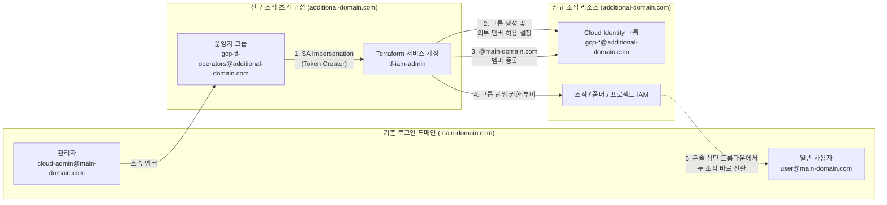

# Multi-Org 환경의 Cloud Identity 그룹 및 GCP IAM 자동화

기존에 사용하던 GCP Organization(`main-domain.com`) 외에 자회사 분리나 신규 사업 등으로 새로운 GCP Organization(`additional-domain.com`)을 하나 더 구성해야 할 때가 있습니다.

이때 실무에서 가장 많이 나오는 요구사항은 **"임직원이 계정을 새로 발급받지 않고, 원래 쓰던 `user@main-domain.com` 계정 하나로 로그인해서 두 조직을 모두 사용할 수 있게 해달라"** 는 것입니다.

이 코드는 신규 조직의 도메인 제한(DRS) 정책을 그대로 유지하면서, 신규 조직 안에 그룹을 만들고 기존 도메인(`@main-domain.com`) 사용자를 멤버로 넣어 GCP 권한을 부여하는 과정을 Terraform으로 자동화한 예제입니다.

---

## 왜 이렇게 구성하나요?

단일 계정으로 두 조직을 쓰려고 할 때 부딪히는 제약은 크게 두 가지입니다.

1. **도메인 제한(DRS) 정책**: 신규 조직은 기본적으로 자기 도메인(`additional-domain.com`) 계정만 IAM에 등록할 수 있게 막혀 있습니다. `@main-domain.com` 개인 계정에 직접 권한을 주려면 DRS 정책에 예외 도메인을 열어야 하는데, 보안상 부담이 큽니다.
2. **그룹 관리 권한**: `@main-domain.com` 계정은 신규 조직 입장에서 외부 사용자이기 때문에, GCP 콘솔에서 신규 조직의 그룹을 직접 만들거나 멤버를 편집할 수 없습니다.

이를 가장 깔끔하게 푸는 방법은 **모든 GCP IAM 권한을 신규 조직의 그룹(`group:gcp-*@additional-domain.com`)에만 부여하고, 실제 사용자(`*@main-domain.com`)는 그 그룹의 멤버로만 넣는 것**입니다.

- DRS 정책은 IAM에 등록되는 그룹의 도메인(`@additional-domain.com`)만 확인하므로 **DRS 설정을 수정할 필요가 없습니다.**
- 신규 조직의 최고 관리자(`superadmin@additional-domain.com`)는 맨 처음 서비스 계정과 초기 그룹을 만들 때 **딱 한 번만 사용**하고, 이후 모든 작업은 기존 도메인 관리자(`cloud-admin@main-domain.com`)가 서비스 계정 키(JSON) 없이 Impersonation으로 실행합니다.



> **참고**: 만약 두 조직이 앞으로도 계속 같은 본사 보안팀 아래에서 통합 관리될 예정이라면, 신규 조직의 DRS 정책에 `main-domain.com`을 허용하고 기존 도메인의 그룹을 그대로 바인딩하는 편이 더 단순합니다. 이 예제는 **신규 조직의 DRS를 열지 않고 독립적인 그룹 체계를 가져가야 하는 경우**에 적합합니다.

---

## 파일 구성 및 기본 그룹

복잡한 `for` 루프를 줄이고 코드를 위에서 아래로 바로 읽을 수 있도록, 그룹 생성과 외부 멤버 허용 설정은 로컬 서브모듈(`./modules/external-group`)로 묶고 `main.tf`에는 그룹별 권한을 정적으로 나열했습니다.

```text
multi-org-group-iam/
├── versions.tf                # Terraform(>= 1.17.0) 및 Google Provider(~> 8.0) 설정
├── variables.tf               # 도메인, 서비스 계정, 그룹별 멤버 및 대상 프로젝트 변수
├── main.tf                    # 그룹 생성 모듈 호출 및 조직/폴더/프로젝트 IAM 바인딩
├── outputs.tf                 # 조회된 조직 정보, 생성된 그룹 이메일, 폴더 ID 출력
├── terraform.tfvars.example   # 변수 입력 예시 파일
└── modules/
    └── external-group/        # 그룹 생성 + 외부 멤버 허용 API 호출 + 도메인 검증 모듈
```

기본으로 구성되는 그룹은 다음과 같습니다.

| 그룹 이메일 (`@additional-domain.com`) | 생성 시점 | 권한 범위 | 부여되는 역할 | 설명 |
| :--- | :--- | :--- | :--- | :--- |
| `gcp-tf-operators@` | 1단계 (수동 1회) | `tf-iam-admin` SA | `Service Account Token Creator` | Terraform을 실행할 관리자가 서비스 계정을 가장(Impersonation)하기 위한 그룹 |
| `gcp-users@` | Terraform | Organization | `Browser` | 신규 조직을 쓰는 모든 사용자. 이 권한이 있어야 **콘솔 상단 조직 드롭다운에 두 조직이 함께 표시**됨 |
| `gcp-org-admins@` | Terraform | Organization | `Organization Admin`<br>`Folder Admin`<br>`Project Creator` | 신규 조직의 폴더 구조와 프로젝트 생성을 관리하는 플랫폼 관리자 그룹 |
| `gcp-app-devs@` | Terraform | `app-dev` 폴더 | `Folder Viewer`<br>`Viewer` | `app-dev` 폴더와 그 하위 리소스만 조회할 수 있는 개발팀 그룹 |
| `gcp-prj-admins@` | Terraform | 지정한 프로젝트들 | `Editor`<br>`Project IAM Admin` | `gcp_prj_admins_project_ids`에 지정한 특정 프로젝트들에 대해서만 관리 권한을 갖는 그룹 |

---

## 따라하기 (Step-by-Step)

실습에는 **Terraform `v1.17.0` 이상**, `gcloud` CLI, `curl`이 필요합니다.

### 1단계. Seed 프로젝트 및 서비스 계정 준비 (최초 1회)

처음 한 번은 신규 조직의 최고 관리자(`superadmin@additional-domain.com`)로 로그인해 Terraform이 사용할 Seed 프로젝트와 서비스 계정, 그리고 운영자 그룹을 만듭니다.

```bash
# 1. 신규 조직 Super Admin으로 로그인하여 조직 ID, Customer ID, 빌링 계정 확인
gcloud auth login superadmin@additional-domain.com
gcloud organizations list
gcloud billing accounts list

# 2. 확인한 값으로 환경 변수 지정
export ADDITIONAL_DOMAIN="additional-domain.com"
export ADDITIONAL_ORG_ID="123456789012"
export ADDITIONAL_CUSTOMER_ID="C02xxxxxx"
export BILLING_ID="01XXXX-XXXXXX-XXXXXX"
export SEED_PROJECT_ID="iam-seed-prod-01"

# 3. Seed 프로젝트 생성, 빌링 연결 및 API 활성화
gcloud projects create "${SEED_PROJECT_ID}" --organization="${ADDITIONAL_ORG_ID}"
gcloud billing projects link "${SEED_PROJECT_ID}" --billing-account="${BILLING_ID}"
gcloud config set project "${SEED_PROJECT_ID}"

gcloud services enable \
  cloudidentity.googleapis.com \
  groupssettings.googleapis.com \
  cloudresourcemanager.googleapis.com \
  iam.googleapis.com \
  iamcredentials.googleapis.com \
  --project="${SEED_PROJECT_ID}"

# 4. Terraform용 서비스 계정 생성 (키 파일은 발급하지 않음) 및 조직 권한 부여
gcloud iam service-accounts create tf-iam-admin \
  --display-name="Terraform Group and IAM Automation SA" \
  --project="${SEED_PROJECT_ID}"

export TF_SA_EMAIL="tf-iam-admin@${SEED_PROJECT_ID}.iam.gserviceaccount.com"

for ROLE in \
  roles/resourcemanager.organizationAdmin \
  roles/resourcemanager.folderAdmin; do
  gcloud organizations add-iam-policy-binding "${ADDITIONAL_ORG_ID}" \
    --member="serviceAccount:${TF_SA_EMAIL}" \
    --role="${ROLE}" \
    --condition=None
done

gcloud projects add-iam-policy-binding "${SEED_PROJECT_ID}" \
  --member="serviceAccount:${TF_SA_EMAIL}" \
  --role="roles/serviceusage.serviceUsageConsumer"

# 5. 운영자 그룹(gcp-tf-operators) 생성 후 서비스 계정 Token Creator 권한 부여
export TF_OPERATOR_GROUP="gcp-tf-operators@${ADDITIONAL_DOMAIN}"

gcloud identity groups create "${TF_OPERATOR_GROUP}" \
  --customer="${ADDITIONAL_CUSTOMER_ID}" \
  --display-name="GCP Terraform Operators" \
  --description="Bootstrap group allowed to impersonate tf-iam-admin Service Account" \
  --billing-project="${SEED_PROJECT_ID}"

# 방금 만든 그룹이 IAM에서 인식될 때까지 잠시 대기
sleep 20

gcloud iam service-accounts add-iam-policy-binding "${TF_SA_EMAIL}" \
  --member="group:${TF_OPERATOR_GROUP}" \
  --role="roles/iam.serviceAccountTokenCreator" \
  --project="${SEED_PROJECT_ID}"
```

---

### 2단계. Google Admin Console 설정 (최초 1회)

그룹에 다른 도메인(`@main-domain.com`) 계정을 넣으려면 Google Admin Console에서 몇 가지 설정을 켜주어야 합니다. `superadmin@additional-domain.com` 계정으로 **[admin.google.com](https://admin.google.com)** 에 접속해 아래 세 가지를 진행합니다.

1. **서비스 계정에 `Groups Admin` 역할 부여**
   - **Account > Admin roles > Groups Admin > Admins > Assign service accounts** 메뉴로 이동해 `tf-iam-admin@iam-seed-prod-01.iam.gserviceaccount.com`을 추가합니다. (별도의 Domain-Wide Delegation 설정은 필요하지 않습니다.)
2. **조직 전체에서 외부 멤버 추가 허용**
   - **Apps > Google Workspace > Groups for Business**로 이동합니다. (꺼져 있다면 먼저 `ON for everyone`으로 켭니다.)
   - **Sharing settings > Sharing options**에서 **`Allow group owners to add external members`** 에 체크하고 저장합니다.
3. **운영자 그룹(`gcp-tf-operators`)에 관리자 계정 등록**
   - **Directory > Groups > `gcp-tf-operators@additional-domain.com`** 을 선택합니다.
   - **Access settings**에서 **`Allow external members`** 를 **ON**으로 바꾸고 저장합니다.
   - **Members > Add members**에서 기존 도메인의 관리자 계정(`cloud-admin@main-domain.com`)을 **`Member`** 로 추가합니다.

설정이 반영되기까지 보통 1~5분 정도 걸립니다. 설정을 마쳤으면 `superadmin@additional-domain.com`에서는 로그아웃합니다.

---

### 3단계. `cloud-admin@main-domain.com`으로 전환 후 Terraform 실행

이제 평소 사용하는 `@main-domain.com` 계정으로 로그인해 Terraform을 실행합니다.

```bash
# 1. 기존 도메인 관리자 계정으로 로그인
gcloud auth login cloud-admin@main-domain.com
gcloud auth application-default login

# 2. 변수 파일 복사 및 수정
cp terraform.tfvars.example terraform.tfvars
```

[`terraform.tfvars.example`](./terraform.tfvars.example)을 참고해 도메인 이름과 서비스 계정 이메일, 각 그룹에 넣을 멤버 목록을 적어줍니다. 조직 ID(`org_id`)나 Customer ID(`C02xxxxxx`)는 코드에서 도메인 이름으로 자동 조회하므로 따로 입력하지 않아도 됩니다.

```bash
terraform init
terraform plan
terraform apply
```

> **참고**: Google Provider에는 아직 그룹의 외부 멤버 허용 옵션(`allowExternalMembers`)을 켜는 네이티브 리소스가 없습니다. 그래서 서브모듈 내부에서 그룹을 만든 직후 단기 토큰(`ephemeral "google_service_account_access_token"`)을 발급받아 Groups Settings API를 1회 호출하도록 구성되어 있습니다. 이 토큰은 메모리에만 잠깐 유지되며 `terraform.tfstate` 파일에는 남지 않습니다.

---

### 4단계. 결과 확인

1. **콘솔에서 조직 전환 확인**: 그룹 멤버로 등록된 `@main-domain.com` 계정으로 GCP 콘솔에 접속해 상단 조직 선택 드롭다운을 열어봅니다. 기존 `main-domain.com` 옆에 `additional-domain.com`이 함께 나타나며, 다시 로그인할 필요 없이 바로 전환됩니다. (권한 전파에 1~5분 정도 걸릴 수 있습니다.)
2. **권한 확인**: `app-dev` 폴더나 `gcp_prj_admins_project_ids`로 지정한 프로젝트의 IAM 탭에 들어가 보면 개인 계정이 아니라 `group:gcp-*@additional-domain.com` 그룹으로 권한이 들어가 있는 것을 볼 수 있습니다.
3. **다른 도메인 입력 차단 확인**: 실수로 `@gmail.com` 같은 외부 이메일을 넣는 것을 막기 위해 모듈 안에 도메인 검증 규칙이 들어 있습니다. `terraform.tfvars`의 멤버 목록에 `"test@gmail.com"`을 넣고 `terraform plan`을 실행해 보면 아래처럼 바로 걸러집니다.

```text
Error: Invalid value for variable

  on main.tf line 25, in module "gcp_users":
  25:   members           = var.gcp_users_members

보안 정책 위반: 모든 그룹 멤버는 허용된 메인 로그인 도메인(@main-domain.com) 계정이어야 합니다.
```

---

## 그룹이나 권한을 추가하려면

새로운 팀 폴더나 그룹이 필요할 때는 [`main.tf`](./main.tf)에 있는 블록을 그대로 복사해서 아래에 붙여넣으면 됩니다.

예를 들어 데이터 팀을 위한 `gcp-data-devs` 그룹을 추가한다면 `main.tf`에 아래처럼 모듈 블록과 IAM 리소스를 추가하고 `terraform init && terraform apply`를 실행하면 됩니다.

```hcl
module "gcp_data_devs" {
  source            = "./modules/external-group"
  customer_id       = data.google_organization.target.directory_customer_id
  group_email       = "gcp-data-devs@${var.additional_domain}"
  display_name      = "GCP Data Developers"
  main_login_domain = var.main_login_domain
  sa_access_token   = ephemeral.google_service_account_access_token.groups_settings.access_token
  members           = ["data-eng1@main-domain.com"]
}
```

실제 운영 환경으로 넘길 때는 Seed 프로젝트 안에 GCS 버킷을 하나 만들어 [`versions.tf`](./versions.tf)의 `backend "gcs"` 주석을 풀고 원격 State로 관리하는 것을 권장합니다.

> [!WARNING]
> 본 에셋은 컨셉 데모용으로 권한을 단순화했습니다. 프로덕션 적용 시 다음을 검토하세요.
> - `gcp-org-admins`의 `organizationAdmin`/`folderAdmin`(조직 루트)은 Seed 프로젝트의 `tf-iam-admin` SA 가장 권한까지 스스로 부여할 수 있습니다 → 조직 루트에는 `folderCreator`/`projectCreator`만 부여
> - `projectIamAdmin`은 해당 프로젝트에서 Owner와 동등 → 필요 시 `modifiedGrantsByRole` IAM Condition으로 제한
> - 그룹 설정 하드닝(`whoCanJoin=INVITED_CAN_JOIN` 등) 및 `deletion_protection = true`

---

## 리소스 정리 (Destroy)

테스트가 끝난 뒤 리소스를 지우려면 아래 순서대로 실행합니다.

```bash
# 1. Terraform으로 만든 그룹, 폴더, IAM 바인딩 삭제 (cloud-admin@main-domain.com 상태)
terraform destroy

# 2. 1단계에서 수동으로 만든 Seed 프로젝트와 초기 그룹까지 모두 지우려면 Super Admin으로 전환
gcloud auth login superadmin@additional-domain.com

export ADDITIONAL_DOMAIN="additional-domain.com"
export ADDITIONAL_ORG_ID="123456789012"
export SEED_PROJECT_ID="iam-seed-prod-01"
export TF_SA_EMAIL="tf-iam-admin@${SEED_PROJECT_ID}.iam.gserviceaccount.com"
export TF_OPERATOR_GROUP="gcp-tf-operators@${ADDITIONAL_DOMAIN}"

gcloud identity groups delete "${TF_OPERATOR_GROUP}" --billing-project="${SEED_PROJECT_ID}" --quiet

for ROLE in \
  roles/resourcemanager.organizationAdmin \
  roles/resourcemanager.folderAdmin; do
  gcloud organizations remove-iam-policy-binding "${ADDITIONAL_ORG_ID}" \
    --member="serviceAccount:${TF_SA_EMAIL}" \
    --role="${ROLE}" \
    --condition=None
done

gcloud projects delete "${SEED_PROJECT_ID}" --quiet
```

마지막으로 [admin.google.com](https://admin.google.com)의 `Account > Admin roles > Groups Admin > Admins`에서 삭제된 `tf-iam-admin` 서비스 계정만 빼주면 초기 상태로 돌아갑니다.

---

## 자주 겪는 오류

| 오류 메시지 / 증상 | 원인 및 해결 방법 |
| :--- | :--- |
| `Error: Organization not found: <domain>` | `additional_domain` 오타가 있거나, 1단계에서 서비스 계정에 부여한 `organizationAdmin` 권한이 아직 전파되지 않은 경우입니다. 1~2분 뒤 다시 실행해 보세요. |
| `Error generating access token ... 403` | 현재 로그인한 계정이 `gcp-tf-operators@` 그룹 멤버가 아니거나 권한 전파 전입니다. 2단계의 외부 멤버 허용 및 멤버 추가 설정을 확인하고 잠시 뒤 다시 시도하세요. |
| `Error 403 ... USER_PROJECT_DENIED` | 서비스 계정에 Seed 프로젝트의 `roles/serviceusage.serviceUsageConsumer` 권한이 빠졌을 때 발생합니다. |
| `Groups Settings API` 호출 시 `403 Not Authorized` | 2단계에서 서비스 계정에 `Groups Admin` 역할을 주지 않았거나, `Groups for Business`의 외부 멤버 허용 체크가 빠진 경우입니다. |
| 콘솔 드롭다운에 신규 조직이 안 보임 | `gcp-users` 그룹에 계정이 포함되어 있는지 확인하고, 반영까지 1~5분 정도 기다린 뒤 브라우저를 새로고침(`Ctrl+Shift+R` / `Cmd+Shift+R`)해 보세요. |
