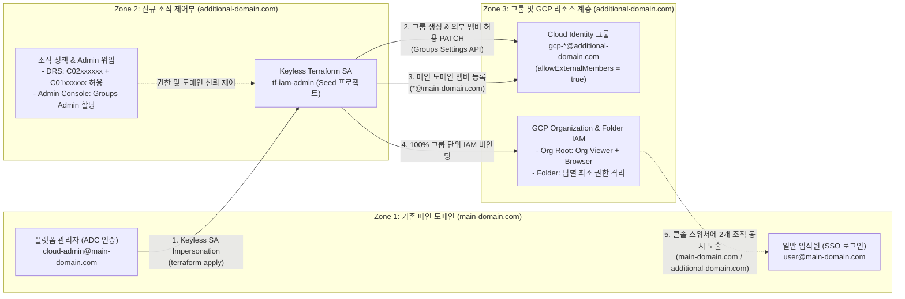
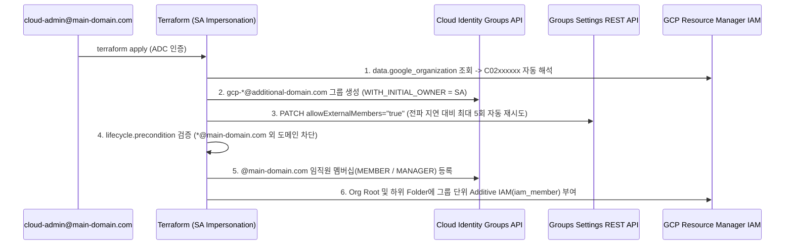

# Multi-Org Cloud Identity Group & GCP IAM Automation (Single SSO Login)

단일 로그인 메인 도메인(`user@main-domain.com`)을 그대로 유지하면서, 신규 분리된 GCP Organization(`additional-domain.com`)의 **Cloud Identity 그룹 생성 · 외부 도메인 멤버 매핑 · GCP IAM 권한 바인딩**을 **Keyless Service Account Impersonation + Terraform**으로 자동화하는 고객 환경 셋업 실습 가이드 및 코드 에셋입니다.

---

## 1. 배경 및 아키텍처 개요

### 1.1 대상 시나리오 및 수동 콘솔 운영의 한계

자회사 분사, 신규 사업부 독립, 규제·컴플라이언스 분리 등의 이유로 별도의 GCP Organization(`additional-domain.com`)을 추가 구축할 때 다음과 같은 요구사항과 제약이 발생합니다.

1. **단일 SSO 로그인 고정**: 전 임직원은 기존 IdP(Okta, Microsoft Entra ID 등)와 연동된 **`user@main-domain.com`** 계정 하나로만 Google Cloud에 로그인합니다.
2. **Cloud Identity 자체 그룹 관리**: 외부 IdP의 그룹 SCIM 동기화를 사용하지 않고, Cloud Identity에서 직접 그룹 및 GCP IAM 권한을 제어합니다.
3. **2개 GCP Organization 동시 노출**: 권한이 부여된 임직원이 GCP Console에 로그인하면 상단 **Organization Switcher(조직 선택 드롭다운)** 에 기존 `main-domain.com`과 신규 `additional-domain.com` 두 조직이 나란히 표시되어 계정 전환 없이 즉시 이동할 수 있어야 합니다.
4. **수동 콘솔 UI 운영의 제약**: `user@main-domain.com`은 `additional-domain.com` 조직 기준 **외부 도메인 계정(External Member)** 이므로, GCP Console UI(`IAM & Admin > Groups`)에서 직접 신규 그룹을 생성하거나 편집하는 작업이 차단됩니다.

> [!IMPORTANT]
> **핵심 해결 원칙 (Keyless SA Impersonation 기반 코드형 관리)**
> - **그룹 객체와 IAM 바인딩**은 신규 조직 도메인(`gcp-*@additional-domain.com`)에 소속시키고, **그룹의 멤버**만 기존 메인 로그인 계정(`*@main-domain.com`)으로 등록합니다.
> - 신규 조직의 `superadmin@additional-domain.com` 계정은 초기 1회 부트스트랩(Step 1~2) 후 물리 MFA를 적용해 **봉인(Break-glass)** 하고 일상 운영에서 사용하지 않습니다.
> - 일상적인 그룹 생성·멤버 변경·폴더/조직 IAM 부여는 승인된 플랫폼 관리자(`cloud-admin@main-domain.com`)가 JSON 키 발급 없이 **Keyless Service Account Impersonation**으로 Terraform을 실행해 관리합니다.

---

### 1.2 예시 도메인 및 환경 식별자 매핑

본 가이드와 Terraform 템플릿은 아래 예시 도메인 및 식별자를 기준으로 작성되어 있습니다. 실습 진행 시 고객사의 실제 값으로 치환하여 사용하세요.

| 구분 | 가이드 예시 값 | 실제 고객사 적용 값 (예시) | 설명 |
| :--- | :--- | :--- | :--- |
| **기존 메인 로그인 도메인** | **`main-domain.com`** | 고객사 본사/통합 SSO 도메인 | 전 임직원이 IdP SSO로 로그인하는 단일 도메인 |
| **메인 도메인 Customer ID** | `C01xxxxxx` | `C`로 시작하는 9자리 ID | `main-domain.com`의 Cloud Identity Directory Customer ID |
| **신규 GCP 조직 도메인** | **`additional-domain.com`** | 신규 분리 조직 도메인 | 추가 구축한 독립 GCP Organization 도메인 |
| **신규 조직 GCP Org ID** | `123456789012` | 12자리 숫자형 ID | `additional-domain.com`의 GCP Organization ID |
| **신규 조직 Customer ID** | `C02xxxxxx` | `C`로 시작하는 9자리 ID | `additional-domain.com`의 Cloud Identity Directory Customer ID |
| **비상용 Super Admin** | `superadmin@additional-domain.com` | 신규 조직 최고 관리자 | Step 1~2 초기 부트스트랩 **1회만 사용 후 봉인** |
| **일상 운영 관리자 (IaC)** | `cloud-admin@main-domain.com` | 클라우드 플랫폼 관리자 | 일상 로그인 및 `terraform apply`를 실행하는 메인 도메인 계정 |
| **일반 사용자 (개발자)** | `app-dev1@main-domain.com` | 서비스 개발자 계정 | 단일 로그인으로 두 조직을 전환하며 업무를 수행하는 계정 |
| **Seed 프로젝트 ID** | `iam-seed-prod-01` | 고객사 네이밍 규칙 적용 | 신규 조직 내 Terraform SA 호스팅 및 API 쿼터 프로젝트 |
| **Keyless Terraform SA** | `tf-iam-admin@iam-seed-prod-01.iam.gserviceaccount.com` | Seed 프로젝트 소속 SA | `Groups Admin` + `Org Admin` 권한을 위임받는 자동화 전용 SA |

---

### 1.3 End-to-End 아키텍처 흐름



---

## 2. 프로젝트 디렉터리 구조

```text
multi-org-group-iam/
├── README.md                  # 고객 환경 셋업 실습 가이드 (본 문서)
├── versions.tf                # Terraform / Google Provider 버전 및 SA Impersonation 설정
├── variables.tf               # 조직 ID, 도메인, Seed 프로젝트, 그룹/역할 스키마 및 입력값 검증 규칙
├── main.tf                    # Customer ID 자동 조회, 그룹 생성, 외부 멤버 허용 PATCH, 멤버십 및 IAM 바인딩
├── outputs.tf                 # 조회된 Directory Customer ID, 생성된 그룹 이메일 및 샘플 폴더 ID 출력
└── terraform.tfvars.example   # main-domain.com / additional-domain.com 기준 변수 템플릿
```

---

## 3. 권장 Cloud Identity 그룹 체계 및 Multi-Org IAM 매트릭스

개인 계정(`user:*@main-domain.com`)에 직접 GCP IAM 역할을 부여하지 않고, **100% 신규 조직 소속 그룹(`group:gcp-*@additional-domain.com`) 단위로만 바인딩**하여 감사 추적성과 권한 가시성을 확보합니다.

| 권장 그룹 (`@additional-domain.com`) | IAM 바인딩 범위 | 핵심 GCP IAM 역할 | 소속 멤버 (`@main-domain.com`) 및 목적 |
| :--- | :--- | :--- | :--- |
| **`gcp-users@additional-domain.com`** *(필수)* | `additional-domain.com` **Org Root** | `roles/resourcemanager.organizationViewer`<br>`roles/browser` | 신규 조직 접근 대상 전 임직원 — **GCP Console 조직 스위처에 두 조직 동시 표시** 및 폴더 트리 조회 (하위 리소스 데이터 접근 권한 없음) |
| **`gcp-org-admins@additional-domain.com`** | `additional-domain.com` **Org Root** | `roles/resourcemanager.organizationAdmin`<br>`roles/resourcemanager.folderAdmin`<br>`roles/resourcemanager.projectCreator` | 클라우드 플랫폼 관리팀 — 폴더 계층 구조, 프로젝트 생성 및 조직 정책 총괄 |
| **`gcp-net-admins@additional-domain.com`** *(확장)* | Shared VPC Folder / Host Project | `roles/compute.networkAdmin`<br>`roles/compute.xpnAdmin` | 네트워크·보안팀 — Shared VPC, 방화벽, 하이브리드 연결 중앙 제어 |
| **`gcp-app-devs@additional-domain.com`** | `app-dev` **Folder** / Project | `roles/resourcemanager.folderViewer`<br>`roles/viewer` *(또는 GKE 등 최소 권한)* | 서비스 개발팀 — 담당 환경 폴더 및 하위 프로젝트 리소스만 격리 접근 |
| **`gcp-billing@additional-domain.com`** *(확장)* | Billing Account & Org Root | `roles/billing.admin` 또는 `roles/billing.viewer` | FinOps·재무팀 — 신규 조직 빌링 계정 비용 모니터링 및 예산 관리 |

---

## 4. Step-by-Step 환경 셋업 실습 가이드

### Step 0. 사전 준비 및 Before 상태 확인

1. **로컬 실습 도구 확인**:
   - [Terraform](https://developer.hashicorp.com/terraform/downloads) `v1.5.0` 이상 (`google` 프로바이더 `>= 6.0.0`)
   - Google Cloud SDK (`gcloud`) 및 `curl` 설치
2. **기존 메인 조직(`main-domain.com`)의 Directory Customer ID 확인**:
   - 기존 조직 관리자를 통해 `main-domain.com`의 `DIRECTORY_CUSTOMER_ID`(`C01xxxxxx`)를 미리 확인합니다.
   ```bash
   gcloud organizations list
   ```
3. **Before 상태 확인 (`user@main-domain.com` 브라우저)**:
   - 크롬 브라우저에서 `cloud-admin@main-domain.com`(또는 `app-dev1@main-domain.com`)으로 `https://console.cloud.google.com` 에 로그인합니다.
   - 상단 리소스 셀렉터의 조직 드롭다운을 열었을 때, 현재는 **`main-domain.com` 1개만 표시되고 `additional-domain.com`은 보이지 않는 상태**임을 확인합니다.

---

### Step 1. 초기 부트스트랩 (1/2) — GCP Seed 프로젝트, Keyless SA 및 조직 정책 설정

> [!NOTE]
> Step 1과 Step 2는 신규 조직 구축 시 비상용 최고 관리자(**`superadmin@additional-domain.com`**)로 **최초 1회만 수행**합니다.

#### 1-1. 신규 조직 ID, Customer ID 및 Billing Account 조회

```bash
# 1. 신규 조직의 비상용 Super Admin 계정으로 로그인
gcloud auth login superadmin@additional-domain.com

# 2. additional-domain.com의 숫자형 ORG_ID 및 C0... 형식 DIRECTORY_CUSTOMER_ID 확인
gcloud organizations list

# 3. Seed 프로젝트에 연결할 Billing Account ID 확인
gcloud billing accounts list
```

**실행 출력 예시:**

```text
$ gcloud organizations list
DISPLAY_NAME           ID            DIRECTORY_CUSTOMER_ID
additional-domain.com  123456789012  C02xxxxxx

$ gcloud billing accounts list
ACCOUNT_ID            NAME                        OPEN  MASTER_ACCOUNT_ID
01XXXX-XXXXXX-XXXXXX  Enterprise Billing Account  True
```

> [!WARNING]
> `ID`(`123456789012`, 숫자형 GCP Organization ID)와 `DIRECTORY_CUSTOMER_ID`(`C02xxxxxx`, Cloud Identity 고객 ID)는 서로 다른 식별자입니다. Cloud Identity Groups API의 `parent`에는 반드시 `C02xxxxxx` 형식이 사용되어야 하며, 본 에셋의 Terraform 코드는 `additional_org_id`만 입력하면 `C02xxxxxx`를 자동 조회합니다.

#### 1-2. 환경 변수 설정, Seed 프로젝트 생성 및 필수 API 6종 활성화

```bash
export ADDITIONAL_ORG_ID="123456789012"       # additional-domain.com의 숫자형 ORG_ID
export ADDITIONAL_CUSTOMER_ID="C02xxxxxx"     # additional-domain.com의 DIRECTORY_CUSTOMER_ID
export MAIN_CUSTOMER_ID="C01xxxxxx"           # main-domain.com의 DIRECTORY_CUSTOMER_ID
export BILLING_ID="01XXXX-XXXXXX-XXXXXX"      # 연결할 Billing Account ID
export SEED_PROJECT_ID="iam-seed-prod-01"     # 신규 조직 내 부트스트랩 프로젝트 ID
export ADMIN_USER="cloud-admin@main-domain.com" # Terraform을 실행할 메인 도메인 관리자 계정

# 1. Seed 프로젝트 생성 및 빌링 연결
gcloud projects create "${SEED_PROJECT_ID}" --organization="${ADDITIONAL_ORG_ID}"
gcloud billing projects link "${SEED_PROJECT_ID}" --billing-account="${BILLING_ID}"
gcloud config set project "${SEED_PROJECT_ID}"

# 2. 필수 API 6종 활성화 (Cloud Identity API + Groups Settings API 포함)
gcloud services enable \
  cloudidentity.googleapis.com \
  groupssettings.googleapis.com \
  cloudresourcemanager.googleapis.com \
  orgpolicy.googleapis.com \
  iam.googleapis.com \
  iamcredentials.googleapis.com \
  --project="${SEED_PROJECT_ID}"
```

#### 1-3. Keyless Terraform Service Account 생성

```bash
# 3. Terraform 자동화 전용 Service Account 생성 (JSON 키 발급 없음)
gcloud iam service-accounts create tf-iam-admin \
  --display-name="Terraform Group and IAM Automation SA" \
  --project="${SEED_PROJECT_ID}"

export TF_SA_EMAIL="tf-iam-admin@${SEED_PROJECT_ID}.iam.gserviceaccount.com"

# Step 2의 Google Admin Console 등록에 사용할 SA 이메일 및 Unique ID 확인
gcloud iam service-accounts describe "${TF_SA_EMAIL}" --format="table(email,uniqueId)"
```

**실행 출력 예시:**

```text
EMAIL                                                  UNIQUE_ID
tf-iam-admin@iam-seed-prod-01.iam.gserviceaccount.com  110722989422038000000
```

#### 1-4. Terraform SA에 신규 조직 관리 권한 및 Seed 프로젝트 쿼터 권한 부여

```bash
# 4. Terraform SA에 신규 Organization 레벨 IAM/Folder/OrgPolicy 관리 권한 부여
for ROLE in \
  roles/resourcemanager.organizationAdmin \
  roles/resourcemanager.folderAdmin \
  roles/orgpolicy.policyAdmin; do
  gcloud organizations add-iam-policy-binding "${ADDITIONAL_ORG_ID}" \
    --member="serviceAccount:${TF_SA_EMAIL}" \
    --role="${ROLE}" \
    --condition=None
done

# 5. Terraform SA가 Seed 프로젝트를 API Quota Project로 사용할 수 있도록 허용 (필수!)
gcloud projects add-iam-policy-binding "${SEED_PROJECT_ID}" \
  --member="serviceAccount:${TF_SA_EMAIL}" \
  --role="roles/serviceusage.serviceUsageConsumer"
```

#### 1-5. Domain Restricted Sharing(DRS) 조직 정책 업데이트 및 SA Impersonation 허용 (순서 엄수!)

신규 GCP 조직은 기본적으로 `iam.allowedPolicyMemberDomains` 조직 정책에 의해 자기 자신의 도메인(`C02xxxxxx`)만 IAM 주체로 허용합니다. 따라서 **반드시 ① DRS 정책에 메인 로그인 도메인(`C01xxxxxx`)을 먼저 추가한 뒤, ② `cloud-admin@main-domain.com`에 Service Account Token Creator 권한을 부여**해야 정책 차단이 발생하지 않습니다.

```bash
# 6. [순서 1] 신규 조직의 DRS 정책에 신규 조직(C02xxxxxx) + 기존 메인 도메인(C01xxxxxx) 허용
cat <<EOF > drs-policy.yaml
name: organizations/${ADDITIONAL_ORG_ID}/policies/iam.allowedPolicyMemberDomains
spec:
  rules:
    - values:
        allowedValues:
          - is:${ADDITIONAL_CUSTOMER_ID}
          - is:${MAIN_CUSTOMER_ID}
          - is:principalSet://iam.googleapis.com/organizations/${ADDITIONAL_ORG_ID}
EOF

gcloud org-policies set-policy drs-policy.yaml
rm -f drs-policy.yaml

# 반영된 DRS 정책 확인
gcloud org-policies describe iam.allowedPolicyMemberDomains --organization="${ADDITIONAL_ORG_ID}"

# 7. [순서 2] 메인 도메인 관리자(cloud-admin@main-domain.com)에 Keyless SA Impersonation 권한 부여
gcloud iam service-accounts add-iam-policy-binding "${TF_SA_EMAIL}" \
  --member="user:${ADMIN_USER}" \
  --role="roles/iam.serviceAccountTokenCreator" \
  --project="${SEED_PROJECT_ID}"
```

#### Step 1 GCP Console 교차 검증 포인트

| 검증 항목 | GCP Console 확인 경로 | 정상 설정 확인 기준 |
| :--- | :--- | :--- |
| **Keyless SA 상태** | Seed 프로젝트(`iam-seed-prod-01`) > `IAM & Admin > Service accounts` | `tf-iam-admin@...` 상태 `Enabled`, **`Key ID: No keys`** (발급된 키 없음) |
| **신규 조직 SA 권한** | 조직(`additional-domain.com`) > `IAM & Admin > IAM` (`tf-iam-admin` 필터) | `Folder Admin`, `Organization Administrator`, `Organization Policy Administrator` 3개 역할 표시 |
| **Seed 쿼터 권한** | Seed 프로젝트(`iam-seed-prod-01`) > `IAM & Admin > IAM` | `tf-iam-admin@...`에 **`Service Usage Consumer`** 역할 직접 부여 확인 |
| **DRS 허용 도메인** | 조직(`additional-domain.com`) > `IAM & Admin > Organization policies` > `Domain restricted sharing` | `Allowed` 값에 `is:C02xxxxxx`(`additional-domain.com`)와 `is:C01xxxxxx`(`main-domain.com`) 모두 포함 |
| **SA 가장 권한** | Seed 프로젝트 > `Service accounts` > `tf-iam-admin` > **`Principals with access`** 탭 | `cloud-admin@main-domain.com` 계정에 **`Service Account Token Creator`** 부여 확인 |

---

### Step 2. 초기 부트스트랩 (2/2) — Google Admin Console 1회 설정

`superadmin@additional-domain.com` 계정으로 **`https://admin.google.com`** 에 접속하여 아래 **2가지**를 설정한 뒤 로그아웃합니다.

1. **Terraform Service Account에 `Groups Admin` 역할 직접 할당 (Domain-Wide Delegation 불필요)**
   - 좌측 메뉴 **Account(계정) > Admin roles(관리자 역할)** 이동
   - **Groups Admin(그룹 관리자)** 선택 → **Admins(관리자)** 클릭 → **`Assign service accounts`(서비스 계정 할당)** 클릭
   - Step 1-3에서 생성한 `tf-iam-admin@iam-seed-prod-01.iam.gserviceaccount.com` 입력 후 **Assign role** 클릭
   - **확인 기준**: `Admins` 목록에 `tf-iam-admin@...` (`Organizational unit: All organizational units`, `Type: Service account`)가 표시되어야 합니다.
2. **외부 도메인 멤버(`@main-domain.com`) 그룹 추가 허용 활성화**
   - 좌측 메뉴 **Apps(앱) > Google Workspace > Groups for Business** 이동
     - *(참고: `Service status`가 `OFF`인 경우 `ON for everyone`으로 먼저 변경)*
   - **Sharing settings(공유 설정) > Sharing options** 클릭
   - **`Allow group owners to add external members` (그룹 소유자가 외부 회원을 허용할 수 있음)** 체크박스를 **체크(ON)** → 우측 하단 **Save** 클릭
3. **전파 대기 및 Super Admin 봉인**:
   - 설정 저장 후 **1~2분간 전파 시간**을 대기한 뒤, `superadmin@additional-domain.com` 세션에서 완전히 로그아웃합니다. 이후 일상 운영에서는 더 이상 이 계정에 로그인하지 않습니다.

---

### Step 3. 단일 로그인 계정(`cloud-admin@main-domain.com`)으로 전환

이제부터 모든 인프라 및 그룹/IAM 운영은 메인 SSO 도메인 계정인 `cloud-admin@main-domain.com`으로만 수행합니다. 로컬 터미널의 `gcloud` CLI 인증(Groups Settings API 호출용)과 Terraform ADC 인증을 모두 전환합니다.

```bash
# 1. gcloud CLI 활성 계정을 메인 도메인 관리자로 전환 (local-exec의 SA 단기 토큰 발급에 사용)
gcloud auth login cloud-admin@main-domain.com

# 2. Terraform Provider가 사용할 ADC(Application Default Credentials)도 동일 계정으로 로그인
gcloud auth application-default login

# 3. 현재 활성 계정이 @main-domain.com인지 확인
gcloud auth list --filter=status:ACTIVE --format="value(account)"
```

---

### Step 4. Terraform 변수 설정 및 자동 배포 (`init` → `plan` → `apply`)

#### 4-1. `terraform.tfvars` 작성

[`terraform.tfvars.example`](./terraform.tfvars.example) 파일을 복사하여 `terraform.tfvars`를 생성하고 실제 환경 값을 입력합니다 (`*.tfvars`는 `.gitignore`에 의해 Git 커밋에서 제외됩니다).

```bash
cp terraform.tfvars.example terraform.tfvars
```

```hcl
additional_org_id        = "123456789012" # additional-domain.com의 숫자형 GCP ORG_ID
# additional_customer_id = "C02xxxxxx"    # (선택) 생략 시 additional_org_id로부터 자동 조회
additional_domain        = "additional-domain.com"
main_login_domain        = "main-domain.com"
seed_project_id          = "iam-seed-prod-01"
tf_service_account_email = "tf-iam-admin@iam-seed-prod-01.iam.gserviceaccount.com"

create_sample_folder       = true
sample_folder_display_name = "app-dev"

groups = {
  users = {
    email_prefix = "gcp-users"
    display_name = "GCP All Users"
    description  = "Grants Org Viewer and Browser so additional-domain.com appears in GCP Organization Switcher"
    members = [
      "cloud-admin@main-domain.com",
      "app-dev1@main-domain.com",
    ]
    org_roles = [
      "roles/resourcemanager.organizationViewer",
      "roles/browser",
    ]
  }

  org_admins = {
    email_prefix = "gcp-org-admins"
    display_name = "GCP Organization Admins"
    description  = "Platform and Organization Administrators for additional-domain.com"
    members      = ["cloud-admin@main-domain.com"]
    managers     = ["cloud-admin@main-domain.com"]
    org_roles = [
      "roles/resourcemanager.organizationAdmin",
      "roles/resourcemanager.folderAdmin",
      "roles/resourcemanager.projectCreator",
    ]
  }

  dev_team = {
    email_prefix = "gcp-app-devs"
    display_name = "GCP App Developers (Dev)"
    description  = "Application developers scoped to the app-dev folder"
    members      = ["app-dev1@main-domain.com"]
    folder_roles = [
      "roles/resourcemanager.folderViewer",
      "roles/viewer",
    ]
  }
}
```

#### 4-2. Terraform 배포 실행

```bash
terraform init
terraform plan
terraform apply
```

#### 4-3. Terraform 내부 4단계 자동화 파이프라인 ([`main.tf`](./main.tf))



1. **Directory Customer ID 자동 해석 (`data.google_organization.additional`)**: 숫자형 `additional_org_id`로부터 `C02xxxxxx` ID를 자동 조회하여 `parent` 입력 실수로 인한 `Error 400`을 원천 방지합니다.
2. **그룹 생성 및 SA 초기 Owner 등록 (`google_cloud_identity_group`)**: `initial_group_config = "WITH_INITIAL_OWNER"` 옵션으로 그룹 생성과 동시에 `tf-iam-admin` SA를 그룹 Owner로 지정합니다.
3. **외부 멤버 허용 자동 활성화 (`terraform_data.enable_external_members`)**: `hashicorp/google` 프로바이더에 네이티브 속성이 없는 `allowExternalMembers` 설정을 SA Impersonation 단기 토큰과 **Groups Settings API (`PATCH /groups/v1/groups/{email}?alt=json`)** 로 자동 활성화합니다.
4. **도메인 검증 및 Additive IAM 바인딩 (`google_cloud_identity_group_membership`, `google_*_iam_member`)**: `@main-domain.com` 도메인 외 계정 유입을 `precondition`으로 검증한 뒤, 기존 조직 권한을 덮어쓰지 않는 `iam_member` 리소스로 권한을 부여합니다.

---

### Step 5. 배포 후 검증 시나리오 (체크리스트)

`terraform apply` 완료 후 그룹 멤버십 → GCP IAM 캐시 전파까지 **약 30~60초**가 소요됩니다. 아래 순서로 정상 동작을 검증합니다.

#### 5-A. Google Admin Console 검증 *(초기 검증 시에만 확인)*

| 확인 위치 | 정상 동작 확인 포인트 |
| :--- | :--- |
| `admin.google.com` > **Directory > Groups** | `gcp-users@additional-domain.com` 등 3개 그룹이 생성되어 있으며, **`Access type: Custom`** 및 **노란색 외부 멤버 허용 배지**가 표시됨 |
| 각 그룹 클릭 > **Members** | `tf-iam-admin@...` 서비스 계정이 **`Owner` (`Service account`)** 로 유지되고, `*@main-domain.com` 임직원 계정이 **`Member` (`User`)** 로 정상 편입됨 |

#### 5-B. GCP Console 검증 (`user@main-domain.com` 단일 로그인 상태)

| 검증 단계 | GCP Console 확인 경로 | 기대 결과 및 거버넌스 효과 |
| :--- | :--- | :--- |
| **① 2개 조직 동시 노출** | 상단 프로젝트/조직 선택 창 → **Organization 드롭다운** | **`main-domain.com`** 과 **`additional-domain.com`** 2개 조직이 나란히 표시되며 재로그인 없이 즉시 전환 가능 |
| **② GCP 그룹 동기화** | `additional-domain.com` 전환 > **`IAM & Admin > Groups`** | Terraform으로 생성한 `gcp-users@`, `gcp-org-admins@`, `gcp-app-devs@additional-domain.com` 그룹 및 멤버 목록 조회 |
| **③ 수동 UI 변경 차단** | `IAM & Admin > Groups` > 그룹 생성 또는 수동 편집 시도 | `@main-domain.com` 외부 계정에는 수동 그룹 생성/수정 권한이 없으므로 UI 변경이 차단되어 **Configuration Drift(우발적 수동 변경) 원천 방지** |
| **④ 폴더 최소 권한 격리** | `app-dev` 폴더 선택 > **`IAM & Admin > IAM`** | 개인 계정(`user:`) 직접 바인딩 없이 `group:gcp-app-devs@additional-domain.com` 그룹에만 `Folder Viewer` / `Viewer` 역할이 격리 부여됨 |

#### 5-C. 비인가 외부 도메인(`@gmail.com`) 차단 가드레일 테스트

`allowExternalMembers = true`가 켜져 있더라도 비인가 외부 계정이 추가되지 않는지 검증합니다.

1. `terraform.tfvars`의 아무 그룹 `members` 리스트에 `"unauthorized-user@gmail.com"`을 임시로 추가합니다.
2. `terraform plan`을 실행합니다.
3. 실제 API 호출 전에 Plan 단계에서 즉시 아래 에러와 함께 차단되는 것을 확인한 뒤 원복합니다.

```text
Error: Resource precondition failed

  on main.tf line 133, in resource "google_cloud_identity_group_membership" "external_domain_members":
 133:       condition     = endswith(each.value.member_email, "@${lower(var.main_login_domain)}")

보안 정책 위반: 허용된 메인 로그인 도메인(@main-domain.com) 계정만 그룹에 추가할 수 있습니다. (입력값: unauthorized-user@gmail.com)
```

---

## 5. 운영 보안 3대 가드레일 (Security Guardrails)

1. **비인가 외부 도메인 코드 레벨 원천 차단**:
   - 그룹 단위로 `allowExternalMembers = true`를 활성화하더라도 Terraform `lifecycle.precondition`이 `@main-domain.com`으로 끝나지 않는 이메일을 `terraform plan` 단계에서 즉시 거부하며, Git PR 코드 리뷰를 통해 이중 통제합니다.
2. **100% Keyless 인증 및 Break-glass Super Admin 봉인**:
   - 신규 조직에 `constraints/iam.disableServiceAccountKeyCreation` 조직 정책을 적용하여 SA JSON 키 파일 유출 위험을 제거하고, `superadmin@additional-domain.com`은 물리 보안 키(FIDO2 MFA) 등록 후 비상시에만 개봉합니다.
3. **Additive IAM 원칙 준수**:
   - 조직 루트(`google_organization_iam_*`)에서 기존 필수 권한을 덮어써 조직 잠금(Lock-out)을 유발할 수 있는 `iam_policy` 및 `iam_binding` 사용을 금지하고, 항상 단일 멤버십만 증분 관리하는 `google_organization_iam_member`와 `google_folder_iam_member`만 사용합니다.

---

## 6. 리소스 정리 (Teardown)

실습 또는 PoC 검증 완료 후 생성된 폴더, IAM 바인딩, 그룹 멤버십 및 Cloud Identity 그룹을 일괄 정리하려면 아래 명령을 실행합니다.

```bash
# 1. Terraform 관리 리소스(폴더, IAM 바인딩, 그룹 멤버십, Cloud Identity 그룹) 일괄 삭제
terraform destroy

# 2. (선택) 초기 부트스트랩용 Seed 프로젝트까지 완전히 제거하려면 Super Admin 로그인 후 삭제
gcloud auth login superadmin@additional-domain.com
gcloud projects delete iam-seed-prod-01
```

> [!TIP]
> 프로덕션 환경에서 샘플 폴더(`app-dev`)만 제거하고 그룹·조직 IAM 체계를 유지하려면 `terraform.tfvars`에서 `create_sample_folder = false`로 변경한 뒤 `terraform apply`를 실행하세요.

---

## 7. 트러블슈팅 플레이북 (Troubleshooting)

| 증상 / 주요 에러 메시지 | 발생 원인 | 해결 방법 (Remediation) |
| :--- | :--- | :--- |
| `Error 400: Invalid resource.parent` (creating Group) | 그룹 `parent` 필드에 `C0...` 형식의 Directory Customer ID 대신 숫자형 `ORG_ID`를 입력함 | `terraform.tfvars`에서 `additional_customer_id`를 생략(주석 처리)하여 `additional_org_id` 기반 자동 조회를 사용하거나 `C02xxxxxx` 값을 정확히 입력 |
| `Error 403: caller does not have required permission to use project ... USER_PROJECT_DENIED` | Terraform SA에 Seed 프로젝트의 쿼터 사용 권한이 없거나 IAM 바인딩 전파 지연 | Step 1-4의 `roles/serviceusage.serviceUsageConsumer` 바인딩을 Seed 프로젝트(`iam-seed-prod-01`)에 부여한 뒤 60초 후 재실행 |
| `Groups Settings API` 호출 시 `HTTP 403` 또는 외부 멤버(`@main-domain.com`) 추가 거부 | Google Admin Console에서 SA에 `Groups Admin`을 할당하지 않았거나 `Allow group owners to add external members` 미체크 | Step 2의 `admin.google.com` 설정 2가지를 확인하고 1~2분 전파 대기 후 `terraform apply` 재실행 |
| Step 1-5에서 `cloud-admin@main-domain.com`에 `serviceAccountTokenCreator` 부여 시 DRS 정책 위반 에러 | 신규 조직의 `iam.allowedPolicyMemberDomains`에 `main-domain.com`의 Customer ID(`is:C01xxxxxx`)를 추가하기 전에 IAM 바인딩을 먼저 실행함 | 반드시 Step 1-5의 순서대로 `gcloud org-policies set-policy drs-policy.yaml`을 먼저 적용한 후 `add-iam-policy-binding` 실행 |
| `terraform apply` 성공 후에도 GCP Console 드롭다운에 `additional-domain.com`이 바로 안 보임 | 신규 그룹 멤버십 → GCP IAM 캐시 전파 지연(약 60초) 또는 해당 계정이 `gcp-users` 그룹(`organizationViewer`)에 누락됨 | 1분 대기 후 브라우저 강력 새로고침(`Ctrl+Shift+R` / `Cmd+Shift+R`) 또는 `gcloud organizations list`로 API 노출 여부 먼저 확인 |
